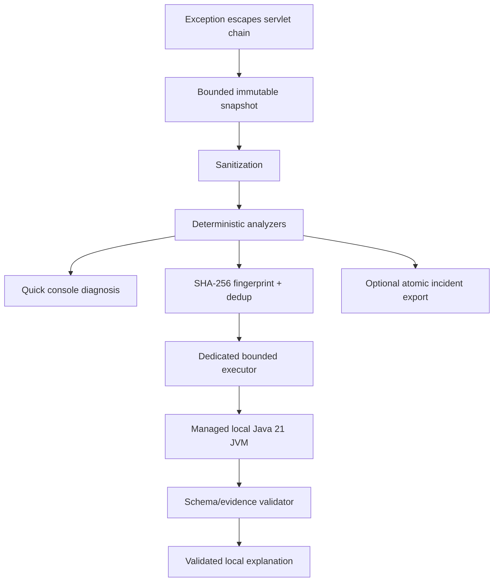

# StackMate

> Your Spring Boot application explains its own failures. Locally.

StackMate is an offline-first diagnostics layer for Spring Boot servlet applications. It observes an exception
that escapes the MVC request chain, copies a small safe snapshot, derives evidence-backed facts, and adds a concise
diagnosis to the same application log. The original exception, HTTP status, response body, Spring exception
handlers, and logging configuration remain owned by the application.

The deterministic engine is the product core. A local model is an optional, experimental explanation layer; it
cannot add evidence or turn an unverified claim into a fact.

Current status: **working deterministic MVP; experimental local inference**. StackMate is not yet presented as
production-ready or published to Maven Central.

Turkish documentation: [README.tr.md](README.tr.md)

## Why StackMate

Spring Boot stack traces are precise but frequently noisy. The useful facts may be separated across wrapper
exceptions, framework frames, SQL metadata, and a single application location. StackMate turns that bounded runtime
evidence into an immediate answer without a cloud API, API key, Python process, Ollama server, telemetry service,
source-code upload, or remote incident store.

The precise claim is **zero external service dependency**. StackMate still has local Java library dependencies and,
when inference is enabled, local model weights and an inference runtime.

## What it does

- Captures unhandled exceptions escaping a Spring MVC servlet request without swallowing them.
- Traverses cyclic/wrapped/suppressed throwable graphs defensively and identifies application frames.
- Recognizes common Java, Spring configuration/MVC/security, JDBC/persistence, network, TLS, DNS, timeout, and
  concurrency patterns without pulling optional frameworks into the core.
- Redacts credential patterns, tokens, connection-string credentials, terminal escapes, and optional PII.
- Prints English or natural Turkish quick diagnoses in box or compact form.
- Computes a normalized SHA-256 fingerprint and suppresses duplicate inference within a bounded TTL store.
- Optionally runs Qwen2.5-0.5B-Instruct through Jlama in a managed Java 21 child process using bounded stdio.
- Validates every model evidence/cause/check/source reference before rendering model prose.
- Optionally exports a sanitized four-file incident bundle through atomic local filesystem publication.

## What it does not do

StackMate does not replace the application's raw stack trace, change HTTP responses, intercept exceptions already
resolved by `@ExceptionHandler`, inspect source code, collect request/response bodies, collect headers or query
values, upload incidents, provide monitoring or tracing, edit code, invoke coding agents, or call cloud/local HTTP
model servers. WebFlux, Spring Boot 3, native-image inference, IDE plugins, log-appender interception, JFR, JVMTI,
and Java-agent instrumentation are outside this version.

## Architecture



Dependency direction:

```text
sample -> local starter -> deterministic starter -> Spring auto-configuration -> core
                      \-> inference JVM adapter -> inference API -> core
benchmark ---------------------------------------------------------> these modules
```

`stackmate-core` is JDK-only. It imports no Spring, servlet, SLF4J, JSON, database, security, or inference runtime.
See [architecture.md](docs/architecture.md) and the [ADRs](docs/adrs/) for the complete boundaries.

## Supported environment

- Java 21
- Spring Boot 4.1.x (this checkout uses 4.1.0)
- Spring Framework 7.0.x (4.1.0 manages 7.0.8)
- Servlet/Spring MVC applications
- Maven 3.9.x (wrapper: 3.9.16)

Spring Boot 3 and WebFlux are intentionally unsupported. The committed CI workflow targets Windows and Linux
verification plus a macOS smoke build; this checkout's workflows have not yet run on a remote GitHub runner.
Real-model process behavior has only been measured locally on Windows.

## Build this checkout

The artifacts are not published. Install this checkout into the local Maven repository first:

```bash
./mvnw clean install
```

Windows PowerShell:

```powershell
$env:JAVA_HOME = 'C:\path\to\jdk-21'
.\mvnw.cmd clean install
```

## Deterministic quickstart

Add the base starter:

```xml
<dependency>
  <groupId>io.github.kalayciburak</groupId>
  <artifactId>stackmate-spring-boot-starter</artifactId>
  <version>0.1.0-SNAPSHOT</version>
</dependency>
```

Optional explicit configuration:

```yaml
stackmate:
  enabled: true
  mode: deterministic
  language: en
  application-packages:
    - com.example.myapp
```

Run the application normally. When a runtime exception escapes the servlet chain, StackMate logs a quick diagnosis
and then returns control to Spring's existing error handling.

## Local-model quickstart

Local inference is experimental. Add the local starter instead of the base starter:

```xml
<dependency>
  <groupId>io.github.kalayciburak</groupId>
  <artifactId>stackmate-spring-boot-starter-local</artifactId>
  <version>0.1.0-SNAPSHOT</version>
</dependency>
```

Provision the official Apache-2.0 Qwen2.5-0.5B-Instruct SafeTensors model directory yourself. StackMate never
downloads it. Configure one of these path sources, in precedence order:

1. `stackmate.inference.model-path`
2. `STACKMATE_MODEL_PATH`
3. `~/.stackmate/models/Qwen2.5-0.5B-Instruct`

```yaml
stackmate:
  mode: hybrid
  inference:
    enabled: true
    model-path: /absolute/path/to/Qwen2.5-0.5B-Instruct
    timeout: 10s
```

Because the evaluated model is `EXPERIMENTAL`, deterministic mode remains the default even with the local starter.
Set `stackmate.mode=hybrid` explicitly to opt in. Missing/invalid models leave deterministic diagnosis active and
produce at most one concise setup warning after inference is first requested.

The model runs asynchronously outside the request thread. The worker uses the installed Java 21 runtime, preview
and vector flags only in the child, and framed standard input/output—not HTTP or a network socket.

## Sample application

Build and run the deterministic demonstration:

```bash
./mvnw -pl stackmate-sample -am package
java -jar stackmate-sample/target/stackmate-sample-0.1.0-SNAPSHOT.jar
```

Trigger representative failures:

```bash
curl -i http://localhost:8080/demo/null-pointer
curl -i http://localhost:8080/demo/invalid-number
curl -i http://localhost:8080/demo/database/duplicate
curl -i http://localhost:8080/demo/repeated
curl -i http://localhost:8080/demo/repeated
curl -i http://localhost:8080/demo/redaction
curl -i http://localhost:8080/demo/prompt-injection
curl -i -H 'Content-Type: application/json' -d '{bad json' \
  http://localhost:8080/demo/malformed-json
curl -i -H 'Content-Type: application/json' -d '{}' \
  http://localhost:8080/demo/validation
```

Turkish output:

```bash
java -jar stackmate-sample/target/stackmate-sample-0.1.0-SNAPSHOT.jar \
  --spring.profiles.active=turkish
```

Hybrid output with an already provisioned model:

```bash
STACKMATE_MODEL_PATH=/absolute/path/to/Qwen2.5-0.5B-Instruct \
java -jar stackmate-sample/target/stackmate-sample-0.1.0-SNAPSHOT.jar \
  --spring.profiles.active=hybrid
```

Disable all capture and analysis with `--spring.profiles.active=disabled` or `--stackmate.enabled=false`.

## Example output

```text
┌─ StackMate · Quick Diagnosis ─────────────────────────────
│ Incident : STM-7A3C1D2E
│ Category : DATABASE_CONSTRAINT
│ Evidence : HIGH
│
│ Summary
│ A database unique constraint rejected the operation.
│
│ First check
│ Check whether the value already exists before retrying.
│
│ Application trace
│ DemoFailureController#databaseDuplicate(DemoFailureController.java:51)
│
│ Source  : deterministic StackMate rules
│ Network : disabled
└────────────────────────────────────────────────────────────
```

The exact incident ID depends on normalized evidence. The application's normal raw exception log remains present.

## Configuration

Safe defaults are shown below. `ansi` is reserved in this MVP; no catch-all startup
analyzer or ANSI output is currently installed. Enabling request body, query value, or header collection is rejected
at configuration binding because those collection paths do not exist.

```yaml
stackmate:
  enabled: true
  mode: deterministic       # set hybrid explicitly for experimental inference
  language: en              # en | tr
  application-packages: []
  capture:
    mvc-unhandled: true
    selected-mdc-keys: [traceId, spanId, correlationId]
  diagnostics:
    maximum-cause-depth: 32
    maximum-suppressed-exceptions: 8
    maximum-stack-frames: 120
    maximum-application-frames: 8
    maximum-message-length: 2000
  privacy:
    include-request-body: false
    include-query-values: false
    include-headers: false
    pii-redaction: true
    custom-redaction-patterns: []
  inference:
    enabled: true
    engine: auto
    deployment: auto
    model-path: ''
    lazy-load: true
    temperature: 0.0        # fixed; non-zero values are rejected
    maximum-input-characters: 16000
    maximum-output-tokens: 256
    timeout: 10s
    repair-attempts: 1
    executor:
      threads: 1
      queue-capacity: 8
    circuit-breaker:
      failure-threshold: 3
      cooldown: 5m
  deduplication:
    enabled: true
    ttl: 10m
    maximum-entries: 512
  console:
    enabled: true
    style: box              # box | compact
    ansi: auto              # reserved; current renderer emits no ANSI
    maximum-width: 100
    show-application-trace: true
    show-technical-details: true
    show-cause-chain: false
    debug-logging: false
  export:
    enabled: false
    directory: .stackmate/incidents
    maximum-incidents: 100
  safety:
    allow-in-production: false
    production-profiles: [prod, production]
```

The production-profile guard is a safety aid, not a security boundary. Explicitly review privacy, load, and local
filesystem policy before enabling diagnostics in a production profile.

## Extension points

Applications may provide Spring beans for `DiagnosticAnalyzer`, `Sanitizer`, `DeduplicationStore`,
`ConsoleRenderer`, `IncidentExporter`, `LocalInferenceEngine`, `InferenceOutputValidator`, and
`InferenceCircuitBreaker`. Default beans back off with Spring Boot conditions. Custom analyzers must return stable
IDs and evidence-backed contributions; they cannot mutate the captured incident.

## Privacy and runtime network policy

StackMate does not collect bodies, headers, cookies, authorization data, query values, session state, environment
values, arbitrary configuration, local variables, bean state, or source files. Console, inference, and export text
is sanitized at their boundaries. Model output is untrusted until schema and reference validation succeeds.

No StackMate runtime code downloads weights, calls a remote inference provider, opens an inference server, uploads
incidents, or emits telemetry. This is not an OS sandbox for third-party bytecode; see the full
[privacy and threat model](docs/privacy-and-threat-model.md).

## Optional incident export

When `stackmate.export.enabled=true`, the first occurrence of a fingerprint is published atomically under:

```text
.stackmate/incidents/STM-XXXXXXXX/
├── incident.json
├── diagnosis.md
├── stacktrace.txt
└── agent-prompt.md
```

The exporter rejects symbolic-link paths, uses fixed digest-derived names, does not copy source, and never invokes
an agent. Retention deletion is limited to recognized bundles and refuses directories with unknown content.

## Benchmark status

The deterministic 50-case controlled corpus currently scores 50/50 for supported category, root type, exact fact,
cause, and check expectations. This is a rule-regression corpus, not a claim of perfect accuracy on arbitrary
applications. Local microbenchmarks and model measurements are recorded in [benchmark.md](docs/benchmark.md).

In the full English prompt-v2 model corpus, structured StackMate input produced 36/50 valid outputs and 72%
category/cause/check accuracy, versus 8/50 valid outputs and 2% category accuracy for raw stack input. Structured
median/P95 latency was 7.21/18.93 seconds; peak worker working set was 2,790 MiB. A corrected five-case Turkish
sample produced 0/5 valid outputs. Structured input clearly beats raw input, but quality, latency, memory, and
Turkish gates fail, so local inference remains `EXPERIMENTAL` and advertises English support only.

Run normal verification without a model:

```bash
./mvnw clean verify
```

Run the explicit 50-case A/B/C model benchmark:

```bash
./mvnw -pl stackmate-benchmark -am -Pmodel-benchmark \
  -Dstackmate.model.path=/absolute/path/to/Qwen2.5-0.5B-Instruct \
  verify
```

Generated machine-specific reports stay under `stackmate-benchmark/target/` and are ignored by Git.

## Known limitations

- Only exceptions escaping the servlet filter chain are visible; resolved handlers and logged-only failures are not.
- Startup failure analysis was investigated but intentionally deferred.
- The application may still expose sensitive text in its unchanged raw logs.
- Optional framework recognition uses safe class-name/message inspection, not deep framework state.
- Local inference misses quality, latency, memory, and Turkish-language gates and has no cross-platform real-model run.
- No OS-level network or model-process sandbox is installed.
- The English manual summary review was 3.53/5 over 36 valid outputs; broader human review is still needed.

## Development

```bash
./mvnw clean verify
./mvnw -pl stackmate-sample -am package
./mvnw -pl stackmate-benchmark -am test
```

See [CONTRIBUTING.md](CONTRIBUTING.md), [troubleshooting.md](docs/troubleshooting.md), and
[progress.md](docs/progress.md). Security reports should follow [SECURITY.md](SECURITY.md).

## Roadmap

Near-term work is evidence-driven: improve analyzer coverage and real integration scenarios, reduce/contain local
model resource use, expand manual Turkish evaluation, add model-process cross-platform validation, and strengthen
release provenance/SBOM checks. WebFlux, optional logging adapters, IDE integration, JFR enrichment, and agent
handoff remain future milestones rather than implied current features.

## License

StackMate is licensed under Apache License 2.0. Model weights are not distributed with StackMate. Review
[THIRD_PARTY_NOTICES.md](THIRD_PARTY_NOTICES.md) before enabling the optional inference module.
