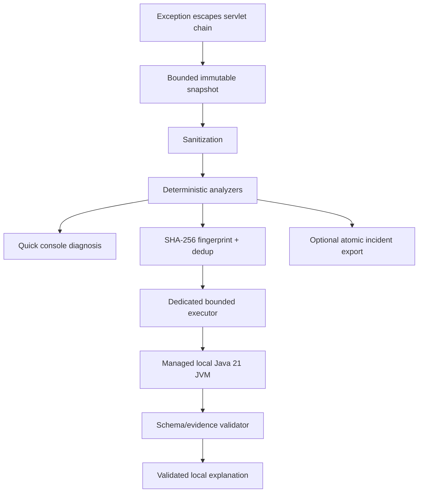

# StackMate

> Your Spring Boot application explains its own failures. Locally.

StackMate is an offline-first diagnostics layer for Spring Boot servlet applications. It observes an exception
that escapes the MVC request chain, copies a small safe snapshot, derives evidence-backed facts, and adds a concise
diagnosis to the same application log. The original exception, HTTP status, response body, Spring exception
handlers, and logging configuration remain owned by the application.

The deterministic engine is the product core. A local model is an optional, untrusted explanation layer; it cannot
add or override a category, root type, evidence item, or source location.

StackMate currently generates runtime diagnostics in English. `README.tr.md` is complete Turkish documentation for
Turkish-speaking developers; it does not imply Turkish runtime output.

Current status: **hardened deterministic MVP; Qwen3.5-2B alignment remains EXPERIMENTAL**. Phase 5.1 improved
strict abstention from 1/11 to 11/11 and generic-fallback misuse from four to zero, but the locked V2 holdout scored
only 16/20 cause/check and manual review still found one accepted unsupported claim. The prompt study is `PARTIAL`,
not a readiness result. Phase 5.2 froze a leakage-audited 1,000-row alignment dataset and a new 30-case challenge,
but adapter training was blocked before F1/F2 because the pinned official safetensors checkpoint was absent and
model download was explicitly out of scope. No adapter, fine-tuned GGUF, persistent llama.cpp worker, production
adapter, or automatic provisioning was built. The local SPI remains for research and safe-fallback testing.
StackMate is not presented as production-ready or published to Maven Central.

Turkish documentation: [README.tr.md](README.tr.md)

## Why StackMate

Spring Boot stack traces are precise but frequently noisy. The useful facts may be separated across wrapper
exceptions, framework frames, SQL metadata, and a single application location. StackMate turns that bounded runtime
evidence into an immediate answer without a cloud API, API key, Python process, Ollama server, telemetry service,
source-code upload, or remote incident store.

The precise claim is **zero external service dependency**. StackMate still has local Java library dependencies and,
when inference is enabled, local model weights and an inference runtime.

## What it does

- Captures unhandled exceptions escaping a Spring MVC servlet request without swallowing them.
- Traverses cyclic/wrapped/suppressed throwable graphs defensively and identifies application frames.
- Recognizes common Java, Spring configuration/MVC/security, JDBC/persistence, network, TLS, DNS, timeout, and
  concurrency patterns without pulling optional frameworks into the core.
- Redacts credential patterns, tokens, connection-string credentials, terminal escapes, and optional PII.
- Prints bounded English quick diagnoses in box or compact form.
- Computes a normalized SHA-256 fingerprint and suppresses duplicate inference within a bounded TTL store.
- Can explicitly run a user-provided supported model through Jlama in a managed Java 21 child process using bounded
  stdio; no evaluated Phase 2 model is recommended.
- Allows model prose to select only supplied evidence/cause/check IDs and validates it before rendering.
- Optionally exports a sanitized four-file incident bundle through atomic local filesystem publication.

## What it does not do

StackMate does not replace the application's raw stack trace, change HTTP responses, intercept exceptions already
resolved by `@ExceptionHandler`, inspect source code, collect request/response bodies, collect headers or query
values, upload incidents, provide monitoring or tracing, edit code, invoke coding agents, or call cloud/local HTTP
model servers. WebFlux, Spring Boot 3, native-image inference, IDE plugins, log-appender interception, JFR, JVMTI,
and Java-agent instrumentation are outside this version.

## Architecture



Dependency direction:

```text
sample -> local starter -> deterministic starter -> Spring auto-configuration -> core
                      \-> inference JVM adapter -> inference API -> core
benchmark ---------------------------------------------------------> these modules
```

`stackmate-core` is JDK-only. It imports no Spring, servlet, SLF4J, JSON, database, security, or inference runtime.
See [architecture.md](docs/architecture.md) and the [ADRs](docs/adrs/) for the complete boundaries.

## Supported environment

- Java 21
- Spring Boot 4.1.x (this checkout uses 4.1.0)
- Spring Framework 7.0.x (4.1.0 manages 7.0.8)
- Servlet/Spring MVC applications
- Maven 3.9.x (wrapper: 3.9.16)

Spring Boot 3 and WebFlux are intentionally unsupported. The committed CI workflow targets Windows and Linux
verification plus a macOS smoke build; this checkout's workflows have not yet run on a remote GitHub runner.
Real-model process behavior has only been measured locally on Windows.

## Build this checkout

The artifacts are not published. Install this checkout into the local Maven repository first:

```bash
./mvnw clean install
```

Windows PowerShell:

```powershell
$env:JAVA_HOME = 'C:\path\to\jdk-21'
.\mvnw.cmd clean install
```

## Deterministic quickstart

Add the base starter:

```xml
<dependency>
  <groupId>io.github.kalayciburak</groupId>
  <artifactId>stackmate-spring-boot-starter</artifactId>
  <version>0.1.0-SNAPSHOT</version>
</dependency>
```

Optional explicit configuration:

```yaml
stackmate:
  enabled: true
  mode: deterministic
  application-packages:
    - com.example.myapp
```

Run the application normally. When a runtime exception escapes the servlet chain, StackMate logs a quick diagnosis
and then returns control to Spring's existing error handling.

## Local-model quickstart

No evaluated local model is recommended for product use; this quickstart describes the retained Phase 2 Jlama
experiment and integration testing. The Phase 5.1 Qwen3.5-2B prompt remains an isolated llama.cpp laboratory result
and was not integrated. Add the local starter instead of the base starter:

```xml
<dependency>
  <groupId>io.github.kalayciburak</groupId>
  <artifactId>stackmate-spring-boot-starter-local</artifactId>
  <version>0.1.0-SNAPSHOT</version>
</dependency>
```

Provision the official Apache-2.0 Qwen2.5-0.5B-Instruct SafeTensors model directory yourself. StackMate never
downloads it. Configure one of these path sources, in precedence order:

1. `stackmate.inference.model-path`
2. `STACKMATE_MODEL_PATH`
3. `~/.stackmate/models/Qwen2.5-0.5B-Instruct`

```yaml
stackmate:
  mode: hybrid
  inference:
    enabled: true
    model-path: /absolute/path/to/Qwen2.5-0.5B-Instruct
    timeout: 10s
```

Deterministic mode remains the default even with the local starter. Set `stackmate.mode=hybrid` explicitly to opt in.
The default `when-enhancement-is-useful` policy skips inference for exact `HIGH` diagnoses and for `LOW`/unknown
diagnoses; only non-fallback `MEDIUM` evidence is submitted. Missing/invalid models leave deterministic diagnosis
active and produce at most one concise setup warning after inference is first requested.

The model runs asynchronously outside the request thread. The worker uses the installed Java 21 runtime, preview
and vector flags only in the child, and framed standard input/output—not HTTP or a network socket.

## Sample application

Build and run the deterministic demonstration:

```bash
./mvnw -pl stackmate-sample -am package
java -jar stackmate-sample/target/stackmate-sample-0.1.0-SNAPSHOT.jar
```

Trigger representative failures:

```bash
curl -i http://localhost:8080/demo/null-pointer
curl -i http://localhost:8080/demo/invalid-number
curl -i http://localhost:8080/demo/database/duplicate
curl -i http://localhost:8080/demo/repeated
curl -i http://localhost:8080/demo/repeated
curl -i http://localhost:8080/demo/redaction
curl -i http://localhost:8080/demo/prompt-injection
curl -i -H 'Content-Type: application/json' -d '{bad json' \
  http://localhost:8080/demo/malformed-json
curl -i -H 'Content-Type: application/json' -d '{}' \
  http://localhost:8080/demo/validation
```

Hybrid output with an already provisioned model:

```bash
STACKMATE_MODEL_PATH=/absolute/path/to/Qwen2.5-0.5B-Instruct \
java -jar stackmate-sample/target/stackmate-sample-0.1.0-SNAPSHOT.jar \
  --spring.profiles.active=hybrid
```

Disable all capture and analysis with `--spring.profiles.active=disabled` or `--stackmate.enabled=false`.

## Example output

```text
┌─ StackMate · Quick Diagnosis ─────────────────────────────
│ Incident : STM-7A3C1D2E
│ Category : DATABASE_CONSTRAINT
│ Evidence : HIGH
│
│ Summary
│ A database unique constraint rejected the operation.
│
│ First check
│ Check whether the value already exists before retrying.
│
│ Application trace
│ DemoFailureController#databaseDuplicate(DemoFailureController.java:51)
│
│ Source  : deterministic StackMate rules
│ Network : disabled
└────────────────────────────────────────────────────────────
```

The exact incident ID depends on normalized evidence. The application's normal raw exception log remains present.

## Configuration

Safe defaults are shown below. `ansi` is reserved in this MVP; no catch-all startup
analyzer or ANSI output is currently installed. Enabling request body, query value, or header collection is rejected
at configuration binding because those collection paths do not exist.

```yaml
stackmate:
  enabled: true
  mode: deterministic       # set hybrid explicitly for experimental inference
  application-packages: []
  capture:
    mvc-unhandled: true
    selected-mdc-keys: [traceId, spanId, correlationId]
  diagnostics:
    maximum-cause-depth: 32
    maximum-suppressed-exceptions: 8
    maximum-stack-frames: 120
    maximum-application-frames: 8
    maximum-message-length: 2000
  privacy:
    include-request-body: false
    include-query-values: false
    include-headers: false
    pii-redaction: true
    custom-redaction-patterns: []
  inference:
    enabled: true
    engine: auto
    deployment: auto
    model-path: ''
    lazy-load: true
    temperature: 0.0        # fixed; non-zero values are rejected
    maximum-input-characters: 16000
    maximum-output-tokens: 256
    timeout: 10s
    repair-attempts: 1
    executor:
      threads: 1
      queue-capacity: 8
    circuit-breaker:
      failure-threshold: 3
      cooldown: 5m
  deduplication:
    enabled: true
    ttl: 10m
    maximum-entries: 512
  console:
    enabled: true
    style: box              # box | compact
    ansi: auto              # reserved; current renderer emits no ANSI
    maximum-width: 100
    show-application-trace: true
    show-technical-details: true
    show-cause-chain: false
    debug-logging: false
  export:
    enabled: false
    directory: .stackmate/incidents
    maximum-incidents: 100
  safety:
    allow-in-production: false
    production-profiles: [prod, production]
```

The production-profile guard is a safety aid, not a security boundary. Explicitly review privacy, load, and local
filesystem policy before enabling diagnostics in a production profile.

## Extension points

Applications may provide Spring beans for `DiagnosticAnalyzer`, `Sanitizer`, `DeduplicationStore`,
`ConsoleRenderer`, `IncidentExporter`, `LocalInferenceEngine`, `InferenceOutputValidator`, and
`InferenceCircuitBreaker`. Default beans back off with Spring Boot conditions. Custom analyzers must return stable
IDs and evidence-backed contributions; they cannot mutate the captured incident.

## Privacy and runtime network policy

StackMate does not collect bodies, headers, cookies, authorization data, query values, session state, environment
values, arbitrary configuration, local variables, bean state, or source files. Console, inference, and export text
is sanitized at their boundaries. Model output is untrusted until schema and reference validation succeeds.

No StackMate runtime code downloads weights, calls a remote inference provider, opens an inference server, uploads
incidents, or emits telemetry. This is not an OS sandbox for third-party bytecode; see the full
[privacy and threat model](docs/privacy-and-threat-model.md).

## Optional incident export

When `stackmate.export.enabled=true`, the first occurrence of a fingerprint is published atomically under:

```text
.stackmate/incidents/STM-XXXXXXXX/
├── incident.json
├── diagnosis.md
├── stacktrace.txt
└── agent-prompt.md
```

The exporter rejects symbolic-link paths, uses fixed digest-derived names, does not copy source, and never invokes
an agent. Retention deletion is limited to recognized bundles and refuses directories with unknown content.

## Benchmark status

The independent frozen V2 corpus has 80 cases (60 development, 20 holdout; 54 real runtime/integration). After
general-purpose hardening, deterministic category accuracy is 74/80 (92.50%), holdout 19/20 (95%), root type 80/80,
unknown restraint 8/8, secret leakage 0, and fingerprint stability 80/80. These are corpus results, not a perfect-
accuracy claim. Full definitions and limitations are in [benchmark-v2-results.md](docs/benchmark-v2-results.md).

Under the explanation-only schema-v2 contract, both Qwen2.5-0.5B-Instruct and Qwen2.5-Coder-0.5B-Instruct produced
0/10 valid English and 0/10 valid Turkish structured outputs. Warm medians were 17.1-22.0 seconds; the measured Coder
worker peak was about 2.09 GiB. Invalid-output fallback succeeded and no invalid result was accepted, but containment
does not establish usefulness. Local inference is therefore `NOT_VIABLE` for the evaluated configurations.

Phase 3 tested pinned Qwen3.5 Q4_K_M feasibility artifacts using official llama.cpp `b10219`. The 2B greedy profile
reached 10/10 English validity and selection, but only 6/10 Turkish cause and 7/10 Turkish check selection, with 3/10
useful Turkish explanations. The 4B model produced valid bilingual JSON in all 40 profile/language cases, but its
best exact cause/check result was 8/10—below the mandatory 85% gate. Gate A failed, so no llama.cpp production
adapter, automatic model catalog, downloader, or provisioning cache was implemented. See the
[Phase 3 screening report](docs/phase-3/model-screening-results.md).

Phase 4 simplified the product to English-only runtime output and ran an independent frozen 20-case tournament
with official llama.cpp `b10221`. SmolLM2-360M produced 0/20 useful explanations. Qwen3-0.6B produced 20/20 valid
and 19/20 useful outputs but only 8/10 holdout check selections, below the mandatory 85% gate. Qwen2.5-1.5B
produced 19/20 valid outputs and missed the selection gates. The Qwen3.5-2B control passed the screen but its
official total is 2,274,069,824 parameters, above the hard cap. No eligible model advanced to the full V2 benchmark
or persistent-worker work. See the [Phase 4 screening report](docs/phase-4/screening-results.md).

Phase 5 removed the strict parameter cap and ran the exact Qwen3.5-2B Q4_K_M control over all 80 Benchmark V2 cases
plus a new frozen 20-case blind corpus. It produced 100/100 valid JSON and 94/100 exact cause/check selections;
holdout and blind selection were each 19/20. Manual review found three accepted unsupported alternatives, and only
1/11 unknown/insufficient cases satisfied the predeclared structured-restraint rule. Gate A therefore failed before
persistent-worker, adapter, or packaged-model work. See the
[Phase 5 qualification report](docs/phase-5/full-qualification-results.md).

Phase 5.1 then compared four frozen prompt variants. The locked P3 prompt produced 40/40 valid outputs, 16/20 V2
holdout and 18/20 blind cause/check accuracy, and 3/3 exact locked abstentions. The holdout gate failed; a required
second manual pass also found one unsupported `high rejection rate` claim in the selection set. Gate C was skipped,
and the model is `EXPERIMENTAL`, not ready. See the
[Phase 5.1 locked report](docs/phase-5-1/locked-final-results.md).

Run normal verification without a model:

```bash
./mvnw clean verify
```

Run the explicit research model benchmark (not part of normal verification):

```bash
./mvnw -pl stackmate-benchmark -am -Pmodel-benchmark \
  -Dstackmate.model.path=/absolute/path/to/Qwen2.5-0.5B-Instruct \
  verify
```

Generated machine-specific reports stay under `stackmate-benchmark/target/` and are ignored by Git.

Run the packaged real-model lifecycle profile with an explicitly provisioned model:

```bash
./mvnw -pl stackmate-e2e -am -Preal-model-e2e \
  -Dstackmate.model.path=/absolute/path/to/local-model \
  verify
```

The profile accepts either a validator-approved local explanation or the bounded deterministic fallback. It verifies
that HTTP returns before inference and that the managed child is removed during shutdown. It is excluded from normal
CI and does not download weights.

## Known limitations

- Only exceptions escaping the servlet filter chain are visible; resolved handlers and logged-only failures are not.
- Startup failure analysis was investigated but intentionally deferred.
- The application may still expose sensitive text in its unchanged raw logs.
- Optional framework recognition uses safe class-name/message inspection, not deep framework state.
- Qwen3.5-2B is `EXPERIMENTAL`; real-model runs exist only on Windows and no model is recommended.
- Phase 3 through Phase 5.1 llama.cpp/GGUF code is explicit benchmark-lab code only; no automatic model or native-runtime
  provisioning exists.
- No OS-level network or model-process sandbox is installed.
- `lazy-load=false` eagerly validates adapter metadata but Jlama weights are still loaded on first inference.

## Development

```bash
./mvnw clean verify
./mvnw -pl stackmate-sample -am package
./mvnw -pl stackmate-benchmark -am test
```

See the [console gallery](docs/console-gallery.md), [Phase 5.1 results](docs/phase-5-1/locked-final-results.md),
[Phase 5.1 manual review](docs/phase-5-1/manual-review.md), [CONTRIBUTING.md](CONTRIBUTING.md), and
[troubleshooting.md](docs/troubleshooting.md). Security reports
should follow [SECURITY.md](SECURITY.md).

## Roadmap

The recommended next local-model phase is task-specific fine-tuning under a new,
separately authorized protocol. Phase 5.1 forbids further prompt variants after this
controlled study. The deterministic product can continue independently; WebFlux,
logging adapters, IDE integration, JFR enrichment, and agent handoff remain future
milestones.

## License

StackMate is licensed under Apache License 2.0. Model weights are not distributed with StackMate. Review
[THIRD_PARTY_NOTICES.md](THIRD_PARTY_NOTICES.md) before enabling the optional inference module.
