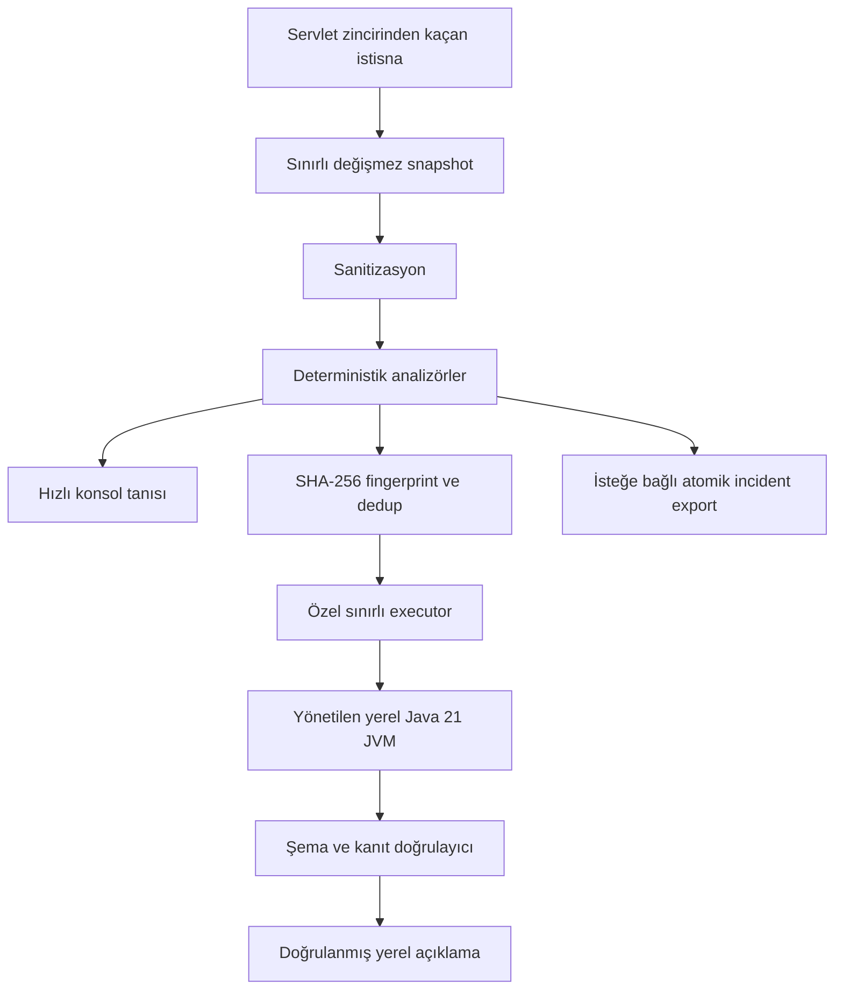

# StackMate

> Spring Boot uygulamanız kendi hatalarını yerel olarak açıklar.

StackMate, Spring Boot servlet uygulamaları için çevrimdışı öncelikli bir tanılama katmanıdır. MVC istek
zincirinden dışarı taşan istisnayı gözlemler, küçük ve güvenli bir anlık görüntü çıkarır, kanıta dayalı olgular
üretir ve aynı uygulama loguna kısa bir tanı ekler. Asıl istisna, HTTP durumu, yanıt gövdesi, Spring exception
handler'ları ve loglama yapılandırması uygulamanın denetiminde kalır.

Ürünün çekirdeği deterministik motordur. Yerel model yalnızca isteğe bağlı ve deneysel bir açıklama katmanıdır;
yeni kanıt ekleyemez veya doğrulanmamış bir iddiayı olguya dönüştüremez.

Güncel durum: **çalışan deterministik MVP; deneysel yerel inference**. StackMate henüz production-ready olarak
sunulmamakta ve Maven Central'da yayımlanmamaktadır.

İngilizce dokümantasyon: [README.md](README.md)

## StackMate neden var?

Spring Boot stack trace'leri kesindir ancak çoğu zaman gürültülüdür. Yararlı bilgi; wrapper exception'lar,
framework frame'leri, SQL metadata'sı ve tek bir uygulama konumu arasına dağılabilir. StackMate bu sınırlı çalışma
zamanı kanıtını cloud API, API anahtarı, Python süreci, Ollama sunucusu, telemetri, kaynak kodu yükleme veya uzak
incident deposu olmadan anlık bir yanıta dönüştürür.

Kesin ürün iddiası **sıfır harici servis bağımlılığıdır**. StackMate'ın yine yerel Java kütüphane bağımlılıkları;
inference açıldığında da yerel model ağırlıkları ve inference runtime'ı vardır.

## Neler yapar?

- Spring MVC servlet istek zincirinden kaçan işlenmemiş istisnaları yutmadan yakalar.
- Döngüsel, wrapper ve suppressed throwable grafiklerini savunmacı biçimde dolaşır; uygulama frame'lerini öne alır.
- Çekirdeğe opsiyonel framework bağımlılığı taşımadan yaygın Java, Spring configuration/MVC/security,
  JDBC/persistence, ağ, TLS, DNS, timeout ve concurrency kalıplarını tanır.
- Credential kalıplarını, token'ları, bağlantı adreslerindeki parolaları, terminal escape karakterlerini ve isteğe
  bağlı PII değerlerini maskeler.
- İngilizce veya doğal teknik Türkçe, kutulu ya da compact hızlı tanı basar.
- Normalize edilmiş SHA-256 fingerprint üretir ve sınırlı TTL deposu içinde yinelenen inference çağrılarını önler.
- İsteğe bağlı olarak Qwen2.5-0.5B-Instruct modelini Jlama ile yönetilen Java 21 child process'inde, sınırlı stdio
  protokolü üzerinden çalıştırır.
- Model metnini göstermeden önce bütün evidence/cause/check/source referanslarını doğrular.
- İsteğe bağlı olarak dört dosyalı temizlenmiş incident paketini atomik biçimde yerel diske yazar.

## Neler yapmaz?

StackMate uygulamanın ham stack trace'inin yerine geçmez, HTTP yanıtını değiştirmez, `@ExceptionHandler` tarafından
çözülmüş istisnaları yakalamaz, kaynak kodu incelemez, istek/yanıt gövdesi, header veya query değeri toplamaz,
incident yüklemez, monitoring/tracing platformu olmaz, kod düzenlemez, coding agent çalıştırmaz ve cloud ya da yerel
HTTP model sunucusu çağırmaz. WebFlux, Spring Boot 3, native-image inference, IDE eklentileri, log appender
interception, JFR, JVMTI ve Java agent instrumentation bu sürümün kapsamı dışındadır.

## Mimari



Bağımlılık yönü:

```text
sample -> local starter -> deterministic starter -> Spring auto-configuration -> core
                      \-> inference JVM adapter -> inference API -> core
benchmark ---------------------------------------------------------> bu modüller
```

`stackmate-core` yalnızca JDK kullanır; Spring, servlet, SLF4J, JSON, database, security veya inference runtime
import etmez. Ayrıntılı sınırlar için [architecture.md](docs/architecture.md) ve [ADR'lere](docs/adrs/) bakın.

## Desteklenen ortam

- Java 21
- Spring Boot 4.1.x (bu checkout 4.1.0 kullanır)
- Spring Framework 7.0.x (Boot 4.1.0, Framework 7.0.8'i yönetir)
- Servlet/Spring MVC uygulamaları
- Maven 3.9.x (wrapper: 3.9.16)

Spring Boot 3 ve WebFlux bilinçli olarak desteklenmez. Commit edilen CI workflow'u Windows ve Linux doğrulaması ile
macOS smoke build hedefler; bu checkout'ın workflow'ları henüz uzak GitHub runner'ında çalışmadı. Gerçek model
child-process davranışı şimdiye kadar yalnızca yerel Windows makinesinde ölçülmüştür.

## Bu checkout'u build etme

Artifact'lar henüz yayımlanmadı. Önce projeyi yerel Maven deposuna kurun:

```bash
./mvnw clean install
```

Windows PowerShell:

```powershell
$env:JAVA_HOME = 'C:\jdk-21\dizini'
.\mvnw.cmd clean install
```

## Deterministik hızlı başlangıç

Temel starter'ı ekleyin:

```xml
<dependency>
  <groupId>io.github.kalayciburak</groupId>
  <artifactId>stackmate-spring-boot-starter</artifactId>
  <version>0.1.0-SNAPSHOT</version>
</dependency>
```

İsteğe bağlı açık yapılandırma:

```yaml
stackmate:
  enabled: true
  mode: deterministic
  language: tr
  application-packages:
    - com.example.uygulamam
```

Uygulamayı normal biçimde çalıştırın. Runtime exception servlet zincirinden dışarı çıktığında StackMate hızlı tanıyı
loglar ve denetimi Spring'in mevcut hata işleme akışına bırakır.

## Yerel model hızlı başlangıcı

Yerel inference deneyseldir. Base starter yerine local starter'ı ekleyin:

```xml
<dependency>
  <groupId>io.github.kalayciburak</groupId>
  <artifactId>stackmate-spring-boot-starter-local</artifactId>
  <version>0.1.0-SNAPSHOT</version>
</dependency>
```

Apache-2.0 lisanslı resmi Qwen2.5-0.5B-Instruct SafeTensors model dizinini kendiniz hazırlayın. StackMate modeli
asla indirmez. Yol aşağıdaki öncelik sırasıyla çözülür:

1. `stackmate.inference.model-path`
2. `STACKMATE_MODEL_PATH`
3. `~/.stackmate/models/Qwen2.5-0.5B-Instruct`

```yaml
stackmate:
  mode: hybrid
  inference:
    enabled: true
    model-path: /mutlak/yol/Qwen2.5-0.5B-Instruct
    timeout: 10s
```

Değerlendirilen model `EXPERIMENTAL` olduğu için local starter kullanıldığında da varsayılan mod deterministiktir.
Inference için `stackmate.mode=hybrid` değerini açıkça verin. Eksik veya geçersiz model deterministik tanıyı açık
bırakır ve inference ilk istendiğinde en fazla bir kısa kurulum uyarısı üretir.

Model servlet request thread'inin dışında asenkron çalışır. Worker kurulu Java 21 runtime'ını kullanır; preview ve
vector bayrakları yalnızca child JVM'dedir. İletişim HTTP veya network socket değil, çerçevelenmiş stdin/stdout'tur.

## Örnek uygulama

Deterministik demoyu build edip çalıştırın:

```bash
./mvnw -pl stackmate-sample -am package
java -jar stackmate-sample/target/stackmate-sample-0.1.0-SNAPSHOT.jar
```

Temsili hataları tetikleyin:

```bash
curl -i http://localhost:8080/demo/null-pointer
curl -i http://localhost:8080/demo/invalid-number
curl -i http://localhost:8080/demo/database/duplicate
curl -i http://localhost:8080/demo/repeated
curl -i http://localhost:8080/demo/repeated
curl -i http://localhost:8080/demo/redaction
curl -i http://localhost:8080/demo/prompt-injection
curl -i -H 'Content-Type: application/json' -d '{bad json' \
  http://localhost:8080/demo/malformed-json
curl -i -H 'Content-Type: application/json' -d '{}' \
  http://localhost:8080/demo/validation
```

Türkçe çıktı:

```bash
java -jar stackmate-sample/target/stackmate-sample-0.1.0-SNAPSHOT.jar \
  --spring.profiles.active=turkish
```

Önceden hazırlanmış modelle hybrid çıktı:

```bash
STACKMATE_MODEL_PATH=/mutlak/yol/Qwen2.5-0.5B-Instruct \
java -jar stackmate-sample/target/stackmate-sample-0.1.0-SNAPSHOT.jar \
  --spring.profiles.active=hybrid
```

Tüm yakalama ve analizi `--spring.profiles.active=disabled` veya `--stackmate.enabled=false` ile kapatın.

## Örnek çıktı

```text
┌─ StackMate · Hızlı Tanı ──────────────────────────────────
│ Olay     : STM-7A3C1D2E
│ Kategori : DATABASE_CONSTRAINT
│ Kanıt    : HIGH
│
│ Özet
│ Veritabanındaki benzersizlik kısıtı işlemi reddetti.
│
│ İlk kontrol
│ Yeniden denemeden önce değerin zaten var olup olmadığını kontrol edin.
│
│ Uygulama izi
│ DemoFailureController#databaseDuplicate(DemoFailureController.java:51)
│
│ Kaynak : deterministik StackMate kuralları
│ Ağ     : kapalı
└────────────────────────────────────────────────────────────
```

Gerçek incident ID normalize edilmiş kanıta göre değişir. Uygulamanın normal ham exception logu görünmeye devam
eder.

## Yapılandırma

Güvenli varsayılanlar aşağıdadır. `ansi` bu MVP'de rezerve edilmiştir; catch-all startup
analyzer veya ANSI çıktı henüz yoktur. Request body, query değeri ya da header toplamayı açmaya çalışmak, bu toplama
yolları uygulanmadığı için configuration binding sırasında reddedilir.

```yaml
stackmate:
  enabled: true
  mode: deterministic       # deneysel inference için hybrid değerini açıkça verin
  language: en              # en | tr
  application-packages: []
  capture:
    mvc-unhandled: true
    selected-mdc-keys: [traceId, spanId, correlationId]
  diagnostics:
    maximum-cause-depth: 32
    maximum-suppressed-exceptions: 8
    maximum-stack-frames: 120
    maximum-application-frames: 8
    maximum-message-length: 2000
  privacy:
    include-request-body: false
    include-query-values: false
    include-headers: false
    pii-redaction: true
    custom-redaction-patterns: []
  inference:
    enabled: true
    engine: auto
    deployment: auto
    model-path: ''
    lazy-load: true
    temperature: 0.0        # sabit; sıfır dışındaki değerler reddedilir
    maximum-input-characters: 16000
    maximum-output-tokens: 256
    timeout: 10s
    repair-attempts: 1
    executor:
      threads: 1
      queue-capacity: 8
    circuit-breaker:
      failure-threshold: 3
      cooldown: 5m
  deduplication:
    enabled: true
    ttl: 10m
    maximum-entries: 512
  console:
    enabled: true
    style: box              # box | compact
    ansi: auto              # rezerve; mevcut renderer ANSI üretmez
    maximum-width: 100
    show-application-trace: true
    show-technical-details: true
    show-cause-chain: false
    debug-logging: false
  export:
    enabled: false
    directory: .stackmate/incidents
    maximum-incidents: 100
  safety:
    allow-in-production: false
    production-profiles: [prod, production]
```

Production profil koruması bir güvenlik yardımcısıdır, security boundary değildir. Production profilinde tanıyı
açmadan önce gizlilik, yük ve yerel dosya sistemi politikalarını ayrıca inceleyin.

## Genişletme noktaları

Uygulamalar `DiagnosticAnalyzer`, `Sanitizer`, `DeduplicationStore`, `ConsoleRenderer`, `IncidentExporter`,
`LocalInferenceEngine`, `InferenceOutputValidator` ve `InferenceCircuitBreaker` türlerinde Spring bean sağlayabilir.
Varsayılan bean'ler Spring Boot condition'larıyla geri çekilir. Özel analizörler kararlı ID ve kanıta bağlı katkı
döndürmeli, yakalanan incident'ı değiştirmemelidir.

## Gizlilik ve runtime ağ politikası

StackMate body, header, cookie, authorization bilgisi, query değeri, session state, environment değeri, gelişigüzel
configuration, local variable, bean state veya kaynak dosyası toplamaz. Konsol, inference ve export metni kendi
sınırlarında sanitize edilir. Model çıktısı şema ve referans doğrulamasından geçene kadar güvenilmezdir.

Hiçbir StackMate runtime kodu model indirmez, uzak inference provider çağırmaz, inference sunucusu açmaz, incident
yüklemez veya telemetri üretmez. Bu, üçüncü taraf bytecode için işletim sistemi sandbox'ı değildir; ayrıntılar
[privacy and threat model](docs/privacy-and-threat-model.md) belgesindedir.

## İsteğe bağlı incident export

`stackmate.export.enabled=true` olduğunda bir fingerprint'in ilk örneği atomik biçimde şu dizine yayımlanır:

```text
.stackmate/incidents/STM-XXXXXXXX/
├── incident.json
├── diagnosis.md
├── stacktrace.txt
└── agent-prompt.md
```

Exporter sembolik bağlantılı yolları reddeder, digest'ten türetilmiş sabit adlar kullanır, kaynak kod kopyalamaz ve
agent çalıştırmaz. Retention temizliği yalnızca tanınan paketlerle sınırlıdır; bilinmeyen içerikli dizinleri silmez.

## Benchmark durumu

50 vakalık kontrollü deterministik corpus, desteklenen kategori, root type, exact fact, cause ve check beklentilerinde
50/50 sonuç vermektedir. Bu bir kural regresyon corpus'udur; rastgele uygulamalarda kusursuz doğruluk iddiası
değildir. Yerel microbenchmark ve model ölçümleri [benchmark.md](docs/benchmark.md) içindedir.

Tam İngilizce prompt-v2 corpus'unda yapılandırılmış StackMate girdisi 36/50 geçerli çıktı ve kategori/cause/check
için %72 doğruluk üretti; ham stack girdisi ise 8/50 geçerli çıktı ve %2 kategori doğruluğunda kaldı.
Yapılandırılmış modda median/P95 gecikme 7,21/18,93 saniye, worker tepe working set'i 2.790 MiB oldu. Düzeltilmiş
beş vakalık Türkçe örnek 0/5 geçerli çıktı verdi. Yapılandırılmış girdi ham girdiden açıkça daha iyi olsa da kalite,
gecikme, bellek ve Türkçe eşikleri geçmedi; bu nedenle inference `EXPERIMENTAL` kalır ve yalnızca İngilizce desteği
bildirir.

Modelsiz normal doğrulama:

```bash
./mvnw clean verify
```

50 vakalık açık A/B/C model benchmark'ı:

```bash
./mvnw -pl stackmate-benchmark -am -Pmodel-benchmark \
  -Dstackmate.model.path=/mutlak/yol/Qwen2.5-0.5B-Instruct \
  verify
```

Makineye özgü raporlar `stackmate-benchmark/target/` altında kalır ve Git tarafından yok sayılır.

## Bilinen sınırlamalar

- Yalnızca servlet filter zincirinden kaçan exception'lar görünür; çözülmüş handler ve sadece loglanan hatalar görünmez.
- Startup failure analizi araştırıldı ancak bilinçli olarak ertelendi.
- Uygulama, değiştirilmemiş ham loglarında hassas metni yine açığa çıkarabilir.
- Opsiyonel framework tanıma, derin framework state yerine güvenli class-name/message incelemesi kullanır.
- Yerel inference kalite, gecikme, bellek ve Türkçe eşiklerini geçmez; gerçek model cross-platform koşusu yoktur.
- İşletim sistemi düzeyinde ağ veya model-process sandbox'ı yoktur.
- İngilizce manuel özet incelemesi 36 geçerli çıktıda 3,53/5'tir; daha geniş insan değerlendirmesi gerekir.

## Geliştirme

```bash
./mvnw clean verify
./mvnw -pl stackmate-sample -am package
./mvnw -pl stackmate-benchmark -am test
```

[CONTRIBUTING.md](CONTRIBUTING.md), [troubleshooting.md](docs/troubleshooting.md) ve
[progress.md](docs/progress.md) belgelerine bakın. Güvenlik bildirimleri [SECURITY.md](SECURITY.md) üzerinden
yapılmalıdır.

## Yol haritası

Yakın dönem çalışmalar kanıt odaklıdır: analizör ve gerçek entegrasyon kapsamını büyütmek, yerel model kaynak
kullanımını azaltmak/sınırlamak, manuel Türkçe değerlendirmeyi genişletmek, model process'ini platformlar arasında
doğrulamak ve release provenance/SBOM kontrollerini güçlendirmek. WebFlux, isteğe bağlı logging adapter'ları, IDE
entegrasyonu, JFR zenginleştirmesi ve agent handoff mevcut özellik gibi sunulmayan gelecek adımlarıdır.

## Lisans

StackMate Apache License 2.0 ile lisanslanır. Model ağırlıkları StackMate ile dağıtılmaz. Opsiyonel inference
modülünü açmadan önce [THIRD_PARTY_NOTICES.md](THIRD_PARTY_NOTICES.md) belgesini inceleyin.
