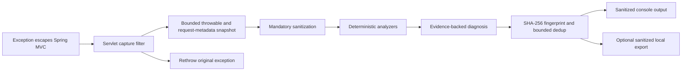

# Architecture

## Public-alpha boundary

StackMate `0.1.0-rc.1` is a deterministic diagnostics library for Java 21 servlet-based Spring MVC applications.
The public release contains four Maven coordinates, with the following dependency direction:

```text
io.github.kalayciburak:stackmate-parent

io.github.kalayciburak:stackmate-core
  <- io.github.kalayciburak:stackmate-spring-boot-autoconfigure
       <- io.github.kalayciburak:stackmate-spring-boot-starter
```

Only the starter is needed by a consumer. Repository modules for inference, local starters, samples, E2E tests,
benchmarks, startup measurement, and research are not public-release artifacts.

## Runtime flow



The filter observes only an exception that escapes the servlet chain. It does not write the HTTP response, select a
status, or replace the throwable. Analysis failures are contained at the StackMate boundary so the original
application flow can continue.

## Module responsibilities

### `stackmate-core`

JDK-only immutable snapshots, throwable traversal, sanitization, application-frame selection, analyzers, diagnosis
aggregation, fingerprinting, bounded deduplication, and export contracts. It has no Spring, Servlet, logging,
database-driver, JSON, model, or inference-runtime dependency.

### `stackmate-spring-boot-autoconfigure`

Strict typed `stackmate.*` properties, Servlet/Spring MVC capture, runtime metadata extraction, production-profile
guard, SLF4J console delivery, and optional filesystem export. Its deterministic analyzers recognize evidence from
common Java, Spring, web, persistence, security, connectivity, timeout, and concurrency failures without adding the
optional frameworks as product requirements.

### `stackmate-spring-boot-starter`

Dependency-only entry point for consumers. It activates auto-configuration by default when the application is a
Servlet web application with Spring MVC classes present. `stackmate.enabled=false` opts out.

## Data boundaries

Captured request metadata is deliberately narrow: method, path, handler identity when available, and values for an
explicit bounded list of MDC keys. StackMate has no public control or implementation path for request bodies, query
values, or header values. It does not inspect source files, local variables, bean state, database contents,
environment variables, or arbitrary configuration values.

Every StackMate-controlled printable or exportable runtime string passes through sanitization. The application's own
logs remain outside this boundary.

## Extension points

Application beans may replace supported boundaries such as `DiagnosticAnalyzer`, `Sanitizer`,
`DeduplicationStore`, `ConsoleRenderer`, or `IncidentExporter`. Extensions must preserve bounded processing,
sanitization, deterministic evidence, and original-exception behavior. Internal implementation classes are not an
API stability promise during the alpha.

## Non-goals for this release

The public release contains no LLM, inference SPI, Jlama adapter, local starter, model, prompt, downloader, native
runtime, network client, telemetry publisher, upload path, sample, E2E harness, or benchmark corpus. Historical
experiments remain in the repository for research traceability only; see
[research/local-llm-findings.md](research/local-llm-findings.md).

WebFlux, startup-failure analysis, arbitrary log interception, Java agents, JFR/JVMTI instrumentation, IDE plugins,
and GraalVM native image are outside the implemented public-alpha boundary.
