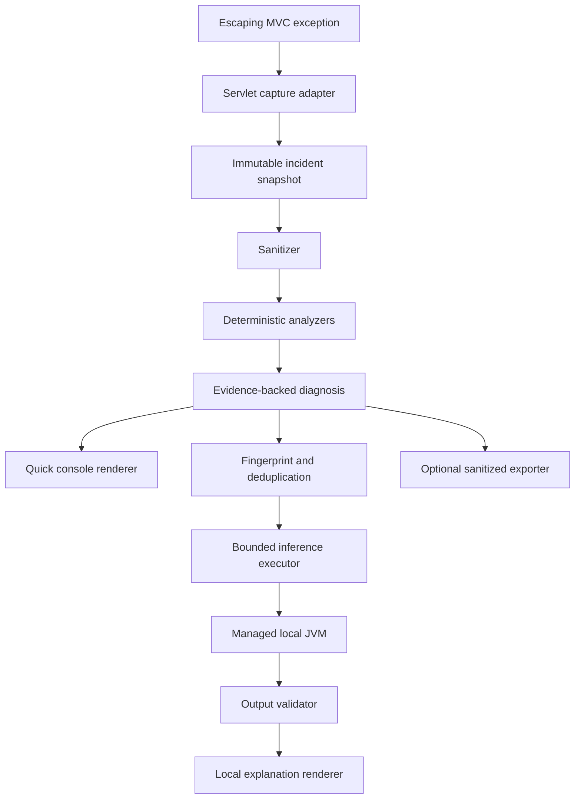

# StackMate architecture

## Architectural intent

StackMate adds bounded, sanitized, evidence-backed diagnostics to a Spring Boot servlet application without
owning its exception response or logging configuration. Deterministic extraction is authoritative. Local model
inference is optional, isolated, asynchronous, and allowed to reference only known facts and candidates.



## Module boundaries

```text
stackmate-sample
  -> stackmate-spring-boot-starter-local
       -> stackmate-spring-boot-starter
            -> stackmate-spring-boot-autoconfigure
                 -> stackmate-core
                 -> stackmate-inference-api (optional)
       -> stackmate-inference-api
       -> stackmate-inference-jvm
            -> stackmate-inference-api
                 -> stackmate-core

stackmate-benchmark
  -> stackmate-core
  -> stackmate-inference-api
  -> stackmate-inference-jvm

stackmate-e2e
  -> packaged stackmate-sample artifact

stackmate-startup-baseline
  -> Spring Boot WebMVC control
  -> deterministic or local starter only through explicit build profiles
```

### `stackmate-core`

JDK-only immutable incident data, defensive throwable traversal, privacy sanitization, application-frame
selection, evidence and analyzers, diagnosis aggregation, fingerprinting, bounded deduplication, and
renderer-neutral results. It imports no Spring, servlet, SLF4J, JSON, database, security, or inference runtime.

### `stackmate-inference-api`

Stable engine-neutral request/result, availability, model descriptor/capability, failure, validation, and circuit
breaker contracts. It may use core domain types but exposes no Jlama type or raw engine JSON.

### `stackmate-inference-jvm`

The Jlama research adapter and versioned, length-prefixed managed Java 21 worker protocol. Jlama is runtime-scoped
here and absent from the deterministic starter. Local files only; no model downloader, HTTP client, server, or
telemetry. Evaluated Phase 2 model configurations are `NOT_VIABLE`; retaining this boundary does not make a model a
diagnostic authority.

### `stackmate-spring-boot-autoconfigure`

Typed properties, conditions, servlet capture, Spring runtime context, SLF4J console output, safe production
profile guard, application custom analyzer discovery, and optional inference orchestration. Optional dependencies
are isolated behind class-presence conditions. Startup failure analysis remains outside the implemented boundary.

### Starters

The base starter aggregates deterministic auto-configuration only. The local starter explicitly adds the
inference API and Jlama adapter. Neither contains model weights.

### Samples, packaged E2E, and benchmark

The sample is intentionally faulty demonstration code only. The benchmark owns controlled ground truth,
deterministic evaluation, raw-versus-structured inference comparison, schema/leakage/injection checks, and JMH
microbenchmarks. Generated machine-specific reports remain under `target/`.

`stackmate-e2e` uses Maven Failsafe to launch the executable sample JAR with `ProcessBuilder`, issue real HTTP
requests, inspect stdout/stderr, shut down the parent, and assert that no observed managed child remains. Its fake
worker uses the real protocol and process lifecycle without model weights. `stackmate-startup-baseline` holds one
minimal WebMVC graph that is packaged with no StackMate, the deterministic starter, and the local starter so startup
deltas are not compared against different applications.

## Runtime invariants

- Capture performs no unbounded recursion, collection, string copy, or queueing.
- StackMate catches failures only at its own boundaries and always rethrows/preserves the application exception.
- Every printable or exportable runtime string is sanitized; model output is sanitized again.
- Model work never runs on the request thread, event dispatcher, or common ForkJoinPool.
- Duplicate incidents reserve at most one inference within the TTL window.
- No runtime component downloads models, calls a cloud provider, opens a network listener, or uploads incidents.
- Severe JVM errors receive only a minimal best-effort message and never trigger inference.

## Extension points

Interfaces exist only at real boundaries: diagnostic analyzers, sanitizer, deduplication store, console renderer,
local inference engine, circuit breaker, and incident exporter. Concrete internal algorithms remain concrete.
Application Spring beans override defaults through conditional auto-configuration without a service locator.

## Exception visibility

The servlet filter sees exceptions escaping the filter chain and reads handler metadata from standard request
attributes when available. It does not see every exception that an application logs and does not intercept
resolved `@ExceptionHandler` flows. See ADR 0009 for the explicit visibility contract.

## Startup failures

Spring Boot's `FailureAnalyzer` mechanism was investigated, but a catch-all analyzer was intentionally not
registered in this MVP. A broad analyzer would compete with Boot's specific built-in startup analyses and cannot
reuse servlet runtime context safely. Runtime MVC completion does not depend on startup analysis; the related
configuration switch is reserved and currently has no effect.
