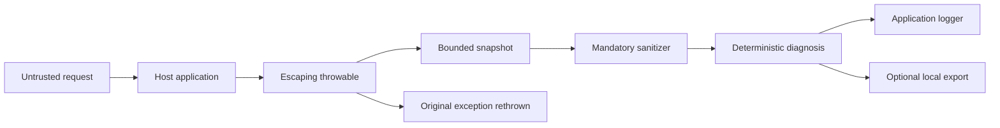

# Privacy and threat model

## Scope

This document covers the `0.1.0-rc.1` public artifacts: deterministic core, Spring Boot auto-configuration, starter,
console output, and optional local export. It does not treat repository research, model, inference, sample,
benchmark, or E2E modules as product capabilities.

Security goals are to preserve host-application behavior, minimize captured data, sanitize StackMate-controlled
output, keep work bounded, avoid network disclosure, and fail safely when StackMate itself encounters an error.

## Data flow

StackMate does not capture request/response bodies, query values, cookies, authorization values, or arbitrary
headers. It may capture method, path, handler identity when available, bounded throwable data, runtime versions,
selected application frames, and values for explicitly selected MDC keys. It does not inspect source code, local
variables, bean state, database contents, environment variables, or arbitrary application configuration.

## Trust boundaries

- Request-controlled text copied by the application into an exception is untrusted.
- Throwable messages, stack metadata, request path, handler metadata, and selected MDC values are untrusted.
- User-supplied literal redaction values and export paths are configuration inputs, not trusted content.
- StackMate's deterministic evidence becomes printable only after bounded capture and sanitization.
- The host application's logging pipeline and its raw exception output are outside StackMate's control.
- The local filesystem and any process able to read it remain outside the export confidentiality boundary.

## Implemented controls and residual risk

| Threat | Implemented control | Residual risk |
| --- | --- | --- |
| Secret or PII disclosure | Mandatory built-in sanitization; no public disable switch; repeated sanitization at output/export boundaries; optional literal `redact-values` | Novel formats can evade rules; framework and application raw logs remain unchanged |
| Excess collection | Narrow metadata model; no body/query/header capture API | Application code can copy sensitive values into throwable messages or MDC |
| Terminal/log injection | Control and terminal escape normalization; bounded plain-text rendering | Host logger/layout behavior is separate |
| Resource exhaustion | Cause, suppressed-exception, frame, message, width, fingerprint-store, TTL, and export-retention bounds | Unique incident storms still consume bounded per-incident CPU and log volume |
| Recursive diagnostic failure | Fail-open adapter boundaries preserve and rethrow the original application exception | StackMate output may be absent when its boundary fails |
| Misdiagnosis | Evidence-backed deterministic rules and explicit unknown fallback | Rules can be incomplete or wrong; output is diagnostic assistance, not authority |
| Path traversal or symlink abuse | Normalized fingerprint-derived directories, symlink rejection, atomic publication, recognized-bundle retention | Filesystem permissions and local users remain operator responsibilities |
| Network disclosure | No downloader, cloud client, telemetry, upload, inference server, or model runtime in public artifacts | This is a code boundary, not an OS sandbox for all host dependencies |
| Production misuse | Known production profiles blocked by default | Profile naming is configurable and the guard is not a security boundary |

## Sanitization contract

Built-in secret and PII rules are mandatory in the configured starter. `stackmate.privacy.redact-values` accepts up
to 32 bounded literal values. Values are matched literally; regular expressions are not accepted through public
configuration. Sanitization lowers risk but does not prove that arbitrary diagnostic text is safe.

Review console output and every exported file before sharing. If a credential appears anywhere, rotate or revoke it
and correct the application code or logging configuration that exposed it.

The external-consumer RC `/failure` observation demonstrated this boundary directly: the StackMate-rendered block
contained zero raw synthetic-secret occurrences, then StackMate rethrew the original exception and Tomcat
independently logged the raw synthetic secret. Preserving application behavior means StackMate cannot be treated as
a control over framework or application logs.

## Local export

Export is off by default. When enabled, a sanitized four-file bundle is written locally. The bundle can still
contain class names, method names, paths, exception text, request paths, timestamps, and deterministic evidence that
an organization considers sensitive. File permissions, backup behavior, disk encryption, retention policy, and
manual sharing are operator responsibilities.

`agent-prompt.md` does not execute anything. Treat it and all incident text as untrusted data if supplied to another
tool.

## Alpha limitations

This public alpha has no security certification, support SLA, production support, or guarantee of complete
sanitization. Production profiles are blocked by default, and overriding the guard requires an independent privacy
and capacity review. Report vulnerabilities as described in [../SECURITY.md](../SECURITY.md).
