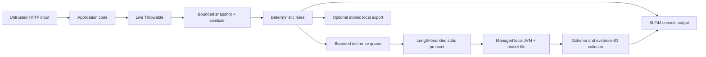

# Privacy and threat model

Status: implemented controls and the Phase 5.1 prompt-qualification boundary reviewed against the
0.1.0-SNAPSHOT architecture on 2026-08-02.

## Scope and security objectives

StackMate observes exceptions that escape the servlet filter chain, creates an immutable bounded snapshot, prints
a deterministic diagnosis, and may send a compact sanitized request to a local managed JVM. Export and inference
are optional. The primary objectives are to keep secrets and PII out of StackMate-controlled output, prevent
attacker-controlled exception text from becoming model instructions or terminal control, bound resource use, keep
all runtime processing local, and preserve the application's original exception and HTTP behavior.

This review covers the core, servlet adapter, console renderer, managed-JVM inference adapter, model files, and
optional filesystem exporter. The application's own logging configuration is outside the trust boundary: because
StackMate intentionally preserves normal logging, the application's raw stack trace can still disclose a secret
that the application placed in an exception message.

Phase 5.1 assumes a local developer checkout on a machine where application request
data can influence exception text, while model/runtime paths and research commands
remain operator-controlled. Its pinned llama.cpp binary and GGUF files are an
ignored, explicit laboratory boundary only. Prompt qualification remained partial, so no native runtime,
GGUF parser, model catalog, downloader, cache, mirror, or background provisioning was
added to the Spring product. The product data flow below therefore remains unchanged.

## Assets

- Credentials, tokens, cookies, connection strings, correlation values, and PII present in runtime text.
- Availability and response semantics of the host Spring Boot application.
- Integrity of deterministic evidence, source locations, and suggested checks.
- Host CPU, memory, process slots, filesystem, and terminal/IDE console.
- Local model weights and the executable classpath used by the managed JVM.
- Sanitized incident bundles when export is explicitly enabled.

## Trust boundaries and data flow

The HTTP request, throwable strings, stack-frame metadata, model file, child-process output, configured filesystem
path, and exported files are all treated as untrusted at their respective boundaries. The deterministic domain
model is trusted only after bounded capture and sanitization. Model prose never becomes evidence.

No runtime component contains a model downloader, cloud-provider client, telemetry publisher, HTTP inference
server, or network fallback. This is a code-level policy, not an operating-system sandbox: a malicious native or
model-runtime dependency could still use capabilities granted to the process.

## Attacker capabilities

An attacker may control request paths and values that application code copies into exception messages; trigger
large, cyclic, suppressed, repeated, or concurrent failures; include prompt-like text, secrets, Unicode, Markdown,
XML-like delimiters, and terminal escape sequences; supply a hostile or malformed local model directory when they
already control StackMate configuration or the filesystem; and race or replace export/model paths using symbolic
links where filesystem permissions allow. A local user with permission to modify the application classpath or
process command line is already inside the deployment trust boundary.

## Threats and implemented controls

| Threat | Abuse path and impact | Implemented controls | Residual risk |
|---|---|---|---|
| Secret or PII leakage | Exception/request/model text reaches console, prompt, fingerprint, or export | Minimal metadata collection; no bodies, headers, cookies, query values, environment values, or system-property dump; default credential/JWT/Base64/hex/JDBC redaction; zero-width/control normalization; fail-closed truncated-JWT handling; optional email, card, and Turkish identity redaction; sanitization at snapshot, prompt, model-output, console, and export boundaries | Novel secret formats may evade patterns; host application's unchanged raw logging remains capable of disclosure |
| Prompt injection | Exception text tells the model to ignore rules, request files, invent evidence, emit commands, or switch language | One versioned English instruction labels incident strings untrusted; bounded facts/candidates with stable IDs; delimiter/control/fence normalization; no tool API; output may select only known evidence/cause/check IDs; non-Latin letter detection; invalid output falls back | A model may still produce persuasive but weak English prose using valid IDs; evaluated inference is not viable |
| Hallucinated facts or locations | Model invents class, method, file, line, constraint, or solution | Deterministic rules are authoritative; the public API exposes only structured output; validator rejects unknown IDs and source references; evidence strength is deterministic; invalid text is not rendered as advice | Natural-language semantic contradictions inside otherwise schema-valid prose are difficult to eliminate completely |
| Terminal injection | ESC/control characters alter terminal display or logs | Snapshot and sanitizer strip control characters and terminal escape sequences; renderer and model output are sanitized again; ANSI is not sourced from incident data | Host logger/layout may add its own control sequences independently |
| Exception storm / denial of service | Repeated failures exhaust request CPU, queue, memory, logs, or inference | Cause/suppressed/frame/message/input/output bounds; SHA-256 fingerprint normalization; bounded TTL duplicate store; atomic inference reservation; one-thread bounded executor; queue rejection and deterministic fallback; timeout, circuit breaker, one-time warning | Unique-fingerprint storms can still cause deterministic/logging cost up to configured bounds; OS-level CPU/memory limits are not imposed by StackMate |
| Recursive failure | StackMate throws while handling an application failure and replaces or repeats it | Capture and every adapter boundary fail open; filter always rethrows the original throwable; recursion guard; StackMate internal failures are debug-only; severe JVM failures skip inference | Extremely low-memory conditions can prevent even best-effort diagnostics; StackMate cannot promise logging success during VM failure |
| Interrupted-thread corruption | Timeout or shutdown clears the caller's interrupt state | Inference never uses the request thread; interrupted waits restore the interrupt flag; shutdown is bounded | Third-party runtime code in the child controls its own interrupt handling |
| Malicious or oversized model | Crafted metadata/weights cause traversal, excessive allocation, unsafe deserialization, or runtime crash | Explicit local path only; no download or remote code; normalized path and symbolic-link checks; required SafeTensors/tokenizer metadata; regular-file checks; bounded aggregate weight size; Qwen dimension bounds; known dtype and exact shape-byte validation; non-overlapping/gap-free/fully-indexed tensor ranges; managed child JVM isolates crashes; parent timeout/circuit breaker/fallback | Jlama parses complex attacker-supplied files and is not an adversarial model sandbox; child currently has the user's filesystem permissions and no hard RSS/CPU limit |
| Native inference crash | JNI/vector/native defect terminates inference or corrupts memory | Production MVP uses Jlama's Java path in a separate JVM; no vendor types cross the API; child exit is a failure result and deterministic mode continues | JVM/JIT/vector defects can still crash the child; parent process creation consumes OS resources |
| Research GGUF/native compromise | A replaced or malicious GGUF exploits the llama.cpp parser, or a replaced native executable runs with the user's permissions | Phase 5 lab pins official model identity, GGUF/runtime revisions, sizes, and SHA-256; uses reviewed llama.cpp `b10223`; excludes RPC/server paths; keeps paths operator-controlled and artifacts ignored; no native component ships or enters application runtime | Third-party GGUF provenance is not cryptographically tied to official weights; native parsing is memory-unsafe; no OS sandbox limits a manually run lab process |
| Semantically unsupported model advice | Grammar-valid prose adds a plausible but unevidenced cause that bypasses identifier checks | Deterministic facts remain authoritative; empty selections require limitations; contradictory selection/limitation states are rejected; frozen adversarial corpus and mandatory two-pass manual review gate integration | Phase 5.1 reduced three accepted alternatives to one, but lexical containment was too imprecise and locked selection quality failed; no model output path was integrated |
| Unsafe future provisioning | Redirect, mirror, race, partial download, or mutable identity activates attacker bytes | Not implemented because Gate A failed; no URL, cache, catalog, lock, download, or activation surface exists | Any future implementation requires a new threat-model review before network or native execution is enabled |
| Stdio protocol abuse | Child emits huge, malformed, delayed, or unsolicited frames | Version-2 length-prefixed bounded protocol; strict duplicate/depth/UTF-8/message checks; request/response IDs; one response per request; sanitized failure kinds; parent timeout; invalid output rejected; no shell interpolation or network socket | A wedged child may require forcible termination; operating-system process semantics vary |
| Unsafe export path / symlink attack | Configured path escapes, follows a link, overwrites files, or retention deletes user content | Export disabled by default; normalized absolute root; existing path-component and target symlink rejection; fixed digest-derived incident directory; four fixed filenames; `CREATE_NEW`; temporary sibling directory plus atomic move; retention considers only `STM-XXXXXXXX` directories and refuses unknown/symlink entries; no recursive delete | A privileged attacker can race path components on filesystems without stronger directory-handle APIs; filesystem may not support atomic directory moves, in which case export fails |
| Incident persistence | Sanitized bundles are read by another local user or retained too long | No persistence by default; configurable bounded retention; sanitized content only; no source/request body/header; no upload or agent execution | File permissions inherit platform defaults; users must protect the chosen directory and backups |
| Network policy regression | A new dependency or future adapter makes a runtime request | No URL/model-download/API-key surface in current runtime; model supplied as a local file; managed IPC uses stdio; normal and benchmark CI do not download weights | Dependency code is not an OS network sandbox; release review should retain dependency-tree and runtime traffic checks |
| Production misuse | Developer diagnostics consume production resources or expose runtime facts | Known production profiles disable analysis unless explicitly allowed and warn once | Profile names are configurable and heuristic, not a security boundary |

## Privacy defaults

The initial version never collects request or response bodies, query-string values, headers, cookies,
authorization data, session state, environment values, arbitrary Spring properties, local variables, bean state,
or source files. Request path is captured without the query string. Only explicitly selected MDC keys are copied,
and their values are sanitized. Export is disabled. Inference is absent from the deterministic starter and is
disabled safely when no valid local model is configured.

Fingerprints use normalized root type/message patterns, category, stable fact types, application frames, and
analyzer versions. UUIDs, timestamps, numeric identifiers, long tokens, and other volatile values are normalized
before hashing; unbounded raw values are not retained by the duplicate store.

## Security validation

Automated tests cover bearer/JWT/password/API-key/JDBC/PII/control/zero-width sanitization, cause cycles and bounds,
prompt-injection delimiters, unknown evidence/cause/check IDs, fabricated source/identifier text, invalid output fallback, inference timeout and
engine failure, bounded queue and duplicate reservation, servlet response preservation, strict protocol framing and
response matching, SafeTensors shape/dtype/range validation, relative/Unicode/symlink model paths, and export
symlink/atomic publication/retention behavior. Normal CI uses a fake engine and never obtains model weights.

Phase 2 classifies the evaluated local models `NOT_VIABLE`. Qwen2.5-0.5B-Instruct and
Qwen2.5-Coder-0.5B-Instruct each produced 0/10 valid structured outputs in both English and Turkish. All 40 invalid
structured responses fell back; accepted unknown IDs, fabricated sources, secret leakage, and prompt-injection
successes were zero. The Coder worker also exceeded the 1.5 GiB target. These results demonstrate containment, not
model usefulness. Cross-platform real-model behavior remains unverified.

Phase 3 also classifies both evaluated quantized configurations `NOT_VIABLE`.
Qwen3.5-2B failed Turkish selection and useful-language gates. Qwen3.5-4B produced
valid bilingual JSON but failed the mandatory 85% exact cause/check selection gate.
Across 80 screening generations, accepted unknown IDs, fabricated source references,
secret leakage, prompt-injection success, and hidden thinking were zero; two invalid
2B responses were quarantined. One schema-valid 4B Turkish explanation still added
an unsupported synchronization cause, demonstrating the residual semantic risk.
Only Windows x86_64 was executed.

Phase 4 tested three eligible English models below 2,000,000,000 total parameters
with llama.cpp `b10221` and an ineligible Qwen3.5-2B control. Across the four
authoritative profiles, accepted unknown IDs, fabricated references, leakage,
prompt-injection success, hidden thinking, timeouts, and crashes were zero. A real
Qwen3-0.6B response containing a Chinese fragment exposed an English-validator gap;
the validator now rejects letters outside the Unicode Latin script, the fragment was
quarantined, and one bounded repair returned valid English output. The strongest
eligible model still missed the holdout check-selection gate, so containment did not
become a readiness claim. Gate C/D native worker and adapter paths were not built.
Only Windows x86_64 was executed for real-model Phase 4 screening.

Phase 5 then removed the parameter cap and ran the exact Qwen3.5-2B Q4_K_M artifact
against 80 frozen V2 and 20 frozen blind cases using llama.cpp `b10223`. Automated
containment observed zero unknown IDs, fabricated source references, secret leakage,
prompt-injection success, or hidden thinking. Manual review nevertheless found three
schema-valid unsupported technical alternatives, and strict unknown/insufficient
restraint passed only 1/11. Gate A failed; persistent-worker, adapter, packaged-model,
and provisioning surfaces were not implemented. Only Windows x86_64 was executed.

Phase 5.1 held the artifact/runtime/corpus controls fixed and varied only four
system prompts. The selected closed-world prompt achieved 11/11 strict abstention
and zero generic fallback misuse, but manual review retained one unsupported rate
claim and V2 locked holdout selection fell to 16/20. A separate eight-attack suite
had zero prompt-injection success, leakage, unknown IDs, source claims, or hidden
thinking, while three attacks caused safe over-abstention. Clause-level evidence
IDs improved auditability without eliminating the unsupported claim. The model is
`EXPERIMENTAL`; worker, adapter, and provisioning surfaces remain absent.

Phase 5.2 adds only isolated research data/configuration. Its 1,000 committed
examples are deterministic synthetic text with no production incident, Ministry or
MHRS data, credential, PII, private path, or model-generated target. A separate
fail-closed audit found zero prohibited overlap with V2 holdout, blind, Phase 5.1
locked-final, and the new 30-case challenge. Training libraries live outside the
Maven graph and model network fallback is disabled. CUDA native-code risk exists
only in the manually invoked WSL research environment. The historical
pre-acquisition report stopped before loading weights; the resumed run later
created local, unpublished F1/F2 adapters and locked outputs, but failed before
merge/export and did not activate a production surface.

## Remaining high-priority mitigations

1. Add an explicit Windows/Linux/macOS runtime traffic test or documented packet-capture procedure.
2. Evaluate child-JVM heap/RSS limits and an opt-in OS sandbox without weakening portability.
3. Add release-time SBOM, dependency vulnerability, and provenance review for Jlama and its transitives.
4. Document recommended filesystem permissions for exported incidents and local model directories.
5. Add sustained property-based fuzzing for the stdio decoder, sanitizer, and SafeTensors metadata beyond the current
   targeted adversarial suite.
6. Keep real inference opt-in and unintegrated while `EXPERIMENTAL` until a materially new containment hypothesis passes frozen
   aggregate, holdout, blind, restraint, and manual semantic-safety gates.
7. If native inference is reconsidered, require reproducible first-party model
   provenance, a pinned source-built runtime, platform-specific process containment,
   and renewed GGUF-parser advisory review before integration.
8. Do not resume Phase 5.2 training unless the exact official base checkpoint is
   supplied locally under a separately authorized, checksum-verified workflow.

The repository-grounded boundary, attacker, abuse-path, and risk-priority review is maintained separately in
`docs/reviews/stackmate-threat-model.md`.

## Phase 5.2 checkpoint-acquisition continuation

The resumed experiment adds a research-only local supply-chain boundary:

| Boundary | Control | Residual risk |
|---|---|---|
| Official checkpoint acquisition | Official `Qwen/Qwen3.5-2B` repository only; immutable revision; bounded `snapshot_download`; file-size and SHA-256 manifest | Upstream bytes and library parsers remain external inputs; no OS sandbox |
| Hugging Face cache | WSL Linux filesystem outside Git; no cache cleanup of unrelated models; offline loading after acquisition | Local users/processes with filesystem access can replace files; permissions remain host-controlled |
| SafeTensors/model load | Local-only load, `trust_remote_code=false`, expected config/tokenizer, no GGUF training fallback | Native CUDA/PyTorch/bitsandbytes code runs with WSL-user permissions |
| Training scripts | Repository scripts are pinned to the lock/config; no telemetry, tracker, upload, or remote inference | Research scripts remain executable code and require review before reuse |
| Adapter serialization | F1/F2 adapters and optimizer state remain outside Git; SHA-256 recorded; one adapter locked before evaluation | Adapter files are not independently signed or published |
| Merge/GGUF | Not reached because locked gates failed; no merged weights or fine-tuned GGUF exist | Future export needs a fresh provenance and conversion review |

The locked run observed zero accepted unsupported claims, fabricated references,
unknown IDs, secret leakage, prompt-injection success, or hidden thinking for the
selected A1 condition. It nevertheless failed accuracy/structure gates, so no
production model path was activated. This continuation does not change the
existing rule that the normal Java product has no model downloader, telemetry,
cloud inference, or Python/ML runtime dependency.

## Phase 5.4 precision-gate stop

The Phase 5.4 smoke and precision diagnostics remained local and offline. BF16 LoRA
was rejected for reserved-VRAM headroom, and NF4 was rejected for restraint and
fallback degradation before any real training. No final-family access control claim
was exercised because the final set remained sealed. The smoke adapter and
checkpoint are ignored WSL artifacts and were not selected, uploaded, merged, or
published.

## Phase 5.3 evaluation and corpus boundary

Phase 5.3 adds controlled local test fixtures and committed synthetic/runtime
research rows, not production telemetry. Ninety families are generated from local
Java, Spring, PostgreSQL, loopback-network, filesystem, concurrency, and security
fixtures; thirty synthetic families cover bounded topology and selection cases.
Every family declares `privateData=false`, and the decoded-JSON scanner plus the
offline leakage audit found zero private path or secret findings.

| Boundary | Control | Residual risk |
|---|---|---|
| Docker/Testcontainers lab | Explicit `Lab` execution only; ephemeral local PostgreSQL; no final-family execution; no normal-build dependency | Docker daemon and image are privileged third-party local inputs |
| Generated development data | `CREATE_NEW`, fixed family split, two variants maximum, full SHA-256 manifest, two byte-identical exports | Controlled lab traces can encode harness-specific artifacts |
| Sealed final metadata | IDs and semantic descriptor hashes only; no request, stack trace, target, or output rendered | Future execution must preserve the seal and one-run rule |
| Offline leakage audit | Prior train/validation, holdout, blind, challenge, parity, and sealed-final comparisons; no network | Similarity thresholds cannot prove absence of every conceptual relation |
| F1 diagnostic | Exact base/adapter/data hashes, NF4/BF16 local load, socket/DNS guard, no repair, T1-only scoring | Native CUDA and bitsandbytes execute with WSL-user permissions |

Invalid F1 outputs never entered a product response. The future plan permits one
separately authorized bounded run only after rechecking hashes; it does not permit
cloud training, data upload, prompt tuning against final, model merge, GGUF export,
worker integration, or provisioning.
