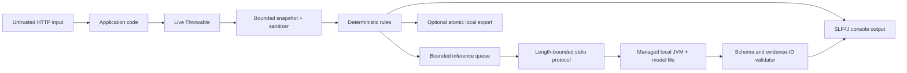

# Privacy and threat model

Status: implemented controls reviewed against the 0.1.0-SNAPSHOT architecture on 2026-08-01.

## Scope and security objectives

StackMate observes exceptions that escape the servlet filter chain, creates an immutable bounded snapshot, prints
a deterministic diagnosis, and may send a compact sanitized request to a local managed JVM. Export and inference
are optional. The primary objectives are to keep secrets and PII out of StackMate-controlled output, prevent
attacker-controlled exception text from becoming model instructions or terminal control, bound resource use, keep
all runtime processing local, and preserve the application's original exception and HTTP behavior.

This review covers the core, servlet adapter, console renderer, managed-JVM inference adapter, model files, and
optional filesystem exporter. The application's own logging configuration is outside the trust boundary: because
StackMate intentionally preserves normal logging, the application's raw stack trace can still disclose a secret
that the application placed in an exception message.

## Assets

- Credentials, tokens, cookies, connection strings, correlation values, and PII present in runtime text.
- Availability and response semantics of the host Spring Boot application.
- Integrity of deterministic evidence, source locations, and suggested checks.
- Host CPU, memory, process slots, filesystem, and terminal/IDE console.
- Local model weights and the executable classpath used by the managed JVM.
- Sanitized incident bundles when export is explicitly enabled.

## Trust boundaries and data flow

The HTTP request, throwable strings, stack-frame metadata, model file, child-process output, configured filesystem
path, and exported files are all treated as untrusted at their respective boundaries. The deterministic domain
model is trusted only after bounded capture and sanitization. Model prose never becomes evidence.

No runtime component contains a model downloader, cloud-provider client, telemetry publisher, HTTP inference
server, or network fallback. This is a code-level policy, not an operating-system sandbox: a malicious native or
model-runtime dependency could still use capabilities granted to the process.

## Attacker capabilities

An attacker may control request paths and values that application code copies into exception messages; trigger
large, cyclic, suppressed, repeated, or concurrent failures; include prompt-like text, secrets, Unicode, Markdown,
XML-like delimiters, and terminal escape sequences; supply a hostile or malformed local model directory when they
already control StackMate configuration or the filesystem; and race or replace export/model paths using symbolic
links where filesystem permissions allow. A local user with permission to modify the application classpath or
process command line is already inside the deployment trust boundary.

## Threats and implemented controls

| Threat | Abuse path and impact | Implemented controls | Residual risk |
|---|---|---|---|
| Secret or PII leakage | Exception/request/model text reaches console, prompt, fingerprint, or export | Minimal metadata collection; no bodies, headers, cookies, query values, environment values, or system-property dump; default credential/JWT/Base64/hex/JDBC redaction; zero-width/control normalization; fail-closed truncated-JWT handling; optional email, card, and Turkish identity redaction; sanitization at snapshot, prompt, model-output, console, and export boundaries | Novel secret formats may evade patterns; host application's unchanged raw logging remains capable of disclosure |
| Prompt injection | Exception text tells the model to ignore rules, request files, invent evidence, or emit commands | Separate versioned English/Turkish instructions label incident strings untrusted; bounded facts/candidates with stable IDs; delimiter/control/fence normalization; no tool API; output may select only known evidence/cause/check IDs; invalid output falls back | A model may still produce persuasive but weak prose using valid IDs; evaluated inference is not viable |
| Hallucinated facts or locations | Model invents class, method, file, line, constraint, or solution | Deterministic rules are authoritative; the public API exposes only structured output; validator rejects unknown IDs and source references; evidence strength is deterministic; invalid text is not rendered as advice | Natural-language semantic contradictions inside otherwise schema-valid prose are difficult to eliminate completely |
| Terminal injection | ESC/control characters alter terminal display or logs | Snapshot and sanitizer strip control characters and terminal escape sequences; renderer and model output are sanitized again; ANSI is not sourced from incident data | Host logger/layout may add its own control sequences independently |
| Exception storm / denial of service | Repeated failures exhaust request CPU, queue, memory, logs, or inference | Cause/suppressed/frame/message/input/output bounds; SHA-256 fingerprint normalization; bounded TTL duplicate store; atomic inference reservation; one-thread bounded executor; queue rejection and deterministic fallback; timeout, circuit breaker, one-time warning | Unique-fingerprint storms can still cause deterministic/logging cost up to configured bounds; OS-level CPU/memory limits are not imposed by StackMate |
| Recursive failure | StackMate throws while handling an application failure and replaces or repeats it | Capture and every adapter boundary fail open; filter always rethrows the original throwable; recursion guard; StackMate internal failures are debug-only; severe JVM failures skip inference | Extremely low-memory conditions can prevent even best-effort diagnostics; StackMate cannot promise logging success during VM failure |
| Interrupted-thread corruption | Timeout or shutdown clears the caller's interrupt state | Inference never uses the request thread; interrupted waits restore the interrupt flag; shutdown is bounded | Third-party runtime code in the child controls its own interrupt handling |
| Malicious or oversized model | Crafted metadata/weights cause traversal, excessive allocation, unsafe deserialization, or runtime crash | Explicit local path only; no download or remote code; normalized path and symbolic-link checks; required SafeTensors/tokenizer metadata; regular-file checks; bounded aggregate weight size; Qwen dimension bounds; known dtype and exact shape-byte validation; non-overlapping/gap-free/fully-indexed tensor ranges; managed child JVM isolates crashes; parent timeout/circuit breaker/fallback | Jlama parses complex attacker-supplied files and is not an adversarial model sandbox; child currently has the user's filesystem permissions and no hard RSS/CPU limit |
| Native inference crash | JNI/vector/native defect terminates inference or corrupts memory | Production MVP uses Jlama's Java path in a separate JVM; no vendor types cross the API; child exit is a failure result and deterministic mode continues | JVM/JIT/vector defects can still crash the child; parent process creation consumes OS resources |
| Stdio protocol abuse | Child emits huge, malformed, delayed, or unsolicited frames | Version-2 length-prefixed bounded protocol; strict duplicate/depth/UTF-8/message checks; request/response IDs; one response per request; sanitized failure kinds; parent timeout; invalid output rejected; no shell interpolation or network socket | A wedged child may require forcible termination; operating-system process semantics vary |
| Unsafe export path / symlink attack | Configured path escapes, follows a link, overwrites files, or retention deletes user content | Export disabled by default; normalized absolute root; existing path-component and target symlink rejection; fixed digest-derived incident directory; four fixed filenames; `CREATE_NEW`; temporary sibling directory plus atomic move; retention considers only `STM-XXXXXXXX` directories and refuses unknown/symlink entries; no recursive delete | A privileged attacker can race path components on filesystems without stronger directory-handle APIs; filesystem may not support atomic directory moves, in which case export fails |
| Incident persistence | Sanitized bundles are read by another local user or retained too long | No persistence by default; configurable bounded retention; sanitized content only; no source/request body/header; no upload or agent execution | File permissions inherit platform defaults; users must protect the chosen directory and backups |
| Network policy regression | A new dependency or future adapter makes a runtime request | No URL/model-download/API-key surface in current runtime; model supplied as a local file; managed IPC uses stdio; normal and benchmark CI do not download weights | Dependency code is not an OS network sandbox; release review should retain dependency-tree and runtime traffic checks |
| Production misuse | Developer diagnostics consume production resources or expose runtime facts | Known production profiles disable analysis unless explicitly allowed and warn once | Profile names are configurable and heuristic, not a security boundary |

## Privacy defaults

The initial version never collects request or response bodies, query-string values, headers, cookies,
authorization data, session state, environment values, arbitrary Spring properties, local variables, bean state,
or source files. Request path is captured without the query string. Only explicitly selected MDC keys are copied,
and their values are sanitized. Export is disabled. Inference is absent from the deterministic starter and is
disabled safely when no valid local model is configured.

Fingerprints use normalized root type/message patterns, category, stable fact types, application frames, and
analyzer versions. UUIDs, timestamps, numeric identifiers, long tokens, and other volatile values are normalized
before hashing; unbounded raw values are not retained by the duplicate store.

## Security validation

Automated tests cover bearer/JWT/password/API-key/JDBC/PII/control/zero-width sanitization, cause cycles and bounds,
prompt-injection delimiters, unknown evidence/cause/check IDs, fabricated source/identifier text, invalid output fallback, inference timeout and
engine failure, bounded queue and duplicate reservation, servlet response preservation, strict protocol framing and
response matching, SafeTensors shape/dtype/range validation, relative/Unicode/symlink model paths, and export
symlink/atomic publication/retention behavior. Normal CI uses a fake engine and never obtains model weights.

Phase 2 classifies the evaluated local models `NOT_VIABLE`. Qwen2.5-0.5B-Instruct and
Qwen2.5-Coder-0.5B-Instruct each produced 0/10 valid structured outputs in both English and Turkish. All 40 invalid
structured responses fell back; accepted unknown IDs, fabricated sources, secret leakage, and prompt-injection
successes were zero. The Coder worker also exceeded the 1.5 GiB target. These results demonstrate containment, not
model usefulness. Cross-platform real-model behavior remains unverified.

## Remaining high-priority mitigations

1. Add an explicit Windows/Linux/macOS runtime traffic test or documented packet-capture procedure.
2. Evaluate child-JVM heap/RSS limits and an opt-in OS sandbox without weakening portability.
3. Add release-time SBOM, dependency vulnerability, and provenance review for Jlama and its transitives.
4. Document recommended filesystem permissions for exported incidents and local model directories.
5. Add sustained property-based fuzzing for the stdio decoder, sanitizer, and SafeTensors metadata beyond the current
   targeted adversarial suite.
6. Keep real inference opt-in and `NOT_VIABLE` until a materially new model/runtime hypothesis passes screening.

The repository-grounded boundary, attacker, abuse-path, and risk-priority review is maintained separately in
`docs/reviews/stackmate-threat-model.md`.
