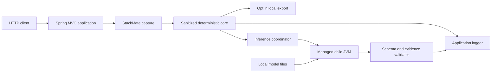

# StackMate repository threat model

Date: 2026-08-02
Scope: deterministic capture/render/export pipeline, optional managed-JVM inference,
and the isolated Phase 4 native/GGUF research lab

## Executive summary

StackMate is a library inside a developer's Spring Boot process, not an independently reachable network service. Its
highest risks are disclosure of secrets carried by attacker-influenced exception data, resource exhaustion caused by
exception storms or untrusted model files, and false advice crossing the child-JVM boundary. Phase 2 reduces those
risks through minimal capture, repeated sanitization, deterministic ownership of facts, bounded IPC and queues,
strict output validation, process isolation, and deterministic fallback. Phase 4 additionally pins native/model
research inputs and excludes server/RPC paths, but its manually executed native process is not an OS sandbox. The
host application's original logging remains outside StackMate's control.

## Scope and assumptions

In scope:

- servlet exception capture, runtime metadata, deterministic analysis, fingerprinting, deduplication, and rendering;
- opt-in incident export;
- local model-path validation, managed-child lifecycle, stdio framing, prompt construction, and output validation;
- normal Maven/CI verification and dependency boundaries that affect shipped runtime artifacts.
- isolated Phase 4 llama.cpp/GGUF screening inputs and execution; no native artifact is shipped.

Out of scope:

- host logging appenders and already-emitted raw exceptions;
- startup failures, WebFlux, log-only failures, repository inspection, agents, IDEs, and cloud providers;
- compromise of the operating system, JDK, Maven repository, or a developer account;
- an OS-enforced CPU, memory, filesystem, or network sandbox.

The product requirements already establish the service context: intended use is local developer diagnostics; the
host application may be network-exposed but StackMate creates no listener; host authentication and authorization
remain application-owned; exception data can contain secrets or PII; and the optional worker runs as the same OS
user. Risk would increase if `stackmate.safety.allow-in-production` were enabled broadly, model files came from an
unverified source, or export directories were readable by other local users.

Open deployment questions that do not block this developer-focused assessment:

- whether future adopters will explicitly enable StackMate in production profiles;
- whether a future release will publish an approved model checksum and provenance policy;
- which filesystem permissions are applied to model and export directories by each supported OS.

## System model

### Primary components

- Servlet capture filter and handler copy bounded throwable/request/runtime facts and rethrow the original exception.
  Evidence: `StackMateExceptionCaptureFilter`, `DefaultServletExceptionCaptureHandler`.
- Core snapshot, sanitizer, analyzers, fingerprinter, and bounded deduplication store produce trusted facts without
  Spring dependencies. Evidence: `ThrowableSnapshotter`, `DefaultSanitizer`, `DiagnosisAggregator`,
  `IncidentFingerprinter`, `BoundedInMemoryDeduplicationStore`.
- Spring output and export adapters render through SLF4J or publish a fixed four-file sanitized bundle. Evidence:
  `DefaultConsoleRenderer`, `FileSystemIncidentExporter`.
- The optional inference coordinator applies the evidence policy and submits bounded asynchronous work. Evidence:
  `EvidenceAwareInferencePolicy`, `DefaultAsyncLocalInferenceCoordinator`.
- The managed child validates local Qwen2 files, communicates through framed stdio, invokes Jlama, and returns
  untrusted schema-v2 output. Evidence: `ModelDirectory`, `Protocol`, `JlamaLocalInferenceEngine`, `JlamaChildMain`.
- The inference API validates known evidence/cause/check IDs and forbidden prose before rendering. Evidence:
  `DefaultInferenceOutputValidator`.

### Data flows and trust boundaries

- HTTP client -> host Spring MVC application: attacker-controlled request data over the host's HTTP channel; host
  authentication, authorization, validation, TLS, and rate limits remain application responsibilities.
- Host application -> StackMate capture: escaping `Throwable` plus minimal method/path/handler/MDC/runtime metadata;
  bounded snapshot traversal and sanitization occur before domain analysis.
- Deterministic engine -> application logger: sanitized diagnosis text through one SLF4J event; terminal controls and
  line widths are bounded, but the host logger separately retains ownership of the raw exception.
- Deterministic engine -> export directory: sanitized fixed filenames through temporary-directory publication and an
  atomic move; export is disabled by default and symlinked roots are rejected.
- Parent JVM -> managed child: sanitized schema-v2 facts over versioned length-prefixed stdin/stdout; frame size,
  JSON depth/duplicates, request IDs, time, queue size, and restarts are bounded.
- Local model -> output validator: model prose is untrusted; only supplied IDs and evidence-backed candidate
  selections survive, while category/root/source/strength always come from deterministic state.
- Build/developer environment -> runtime classpath and model directory: Maven artifacts and explicitly provisioned
  model files cross a supply-chain boundary; Maven Enforcer, pinned versions, size/shape checks, and documented
  checksums reduce but do not remove this trust.
- Research operator -> ignored llama.cpp/GGUF lab: immutable source revisions, expected bytes, and SHA-256 are
  checked before local execution, but third-party conversions are not cryptographic proof of upstream weight
  identity and native GGUF parsing remains memory-unsafe.

#### Diagram

## Assets and security objectives

| Asset | Why it matters | Security objective |
|---|---|---|
| Original exception and HTTP behavior | Diagnostics must never replace application behavior | Integrity, availability |
| Runtime secrets and PII | Messages, MDC, paths, and model text may carry credentials or personal data | Confidentiality |
| Deterministic evidence | Incorrect facts can misdirect debugging or conceal a real failure | Integrity |
| Servlet request threads | Model latency must not degrade application request handling | Availability |
| CPU, heap, disk, and process table | Exception storms and model files can exhaust developer resources | Availability |
| Console output | Escape sequences or false authority can spoof trusted diagnostics | Integrity, confidentiality |
| Model and inference protocol | Malformed files or frames cross into a complex parser/runtime | Integrity, availability |
| Incident export | Local bundles may persist sensitive operational context | Confidentiality, integrity |
| Build artifacts and dependency graph | A compromised dependency would execute in the host or worker JVM | Integrity, confidentiality |

## Attacker model

### Capabilities

- A remote caller can trigger failing requests and influence paths, validation/database messages, and some exception
  text through the host application.
- A caller can generate repeated, concurrent, or high-cardinality failures.
- Application code or a custom analyzer can supply hostile throwable, MDC, handler, or candidate strings.
- A local attacker or careless developer can provide a malformed model directory or unsafe export target.
- A compromised child/runtime can emit malformed, partial, delayed, oversized, or secret-bearing output.

### Non-capabilities

- A remote HTTP caller cannot configure StackMate, install model files, enable export, or read local bundles through a
  StackMate endpoint because no such endpoint exists.
- The model has no StackMate tool, source-repository, shell, or network API.
- The child JVM is not privileged over the parent and does not become a sandbox merely because it is a process.
- StackMate cannot suppress secrets independently emitted by the host application's unchanged raw logging.

## Entry points and attack surfaces

| Surface | How reached | Trust boundary | Notes | Evidence |
|---|---|---|---|---|
| Escaping servlet exception | Failing HTTP request | Host application -> capture | Original throwable is rethrown; only minimal request metadata is copied | `StackMateExceptionCaptureFilter#doFilterInternal` |
| Throwable and runtime strings | Cause/frame/MDC/handler extraction | Untrusted runtime data -> core | Traversal, strings, frames, causes, and suppressed nodes are bounded | `ThrowableSnapshotter#capture`, `ServletContextExtractor` |
| Custom extension beans | Application configuration | Application code -> StackMate SPI | Extensions are trusted code but failures must fail open | `StackMateAutoConfiguration` |
| Model directory | Explicit property/environment/home path | Local filesystem -> worker | No runtime download; symlinks, sizes, dimensions, dtype, and tensor ranges are checked | `ModelDirectory#validate` |
| Child stdin/stdout/stderr | Managed process | Parent JVM <-> child JVM | Length-prefixed protocol; stderr is private, bounded, and sanitized | `Protocol`, `ManagedChild` |
| Model prose | Child response | Untrusted model -> validator | Schema v2 permits explanation and supplied-ID selection only | `DefaultInferenceOutputValidator#validate` |
| Export directory | Explicit opt-in configuration | Deterministic engine -> filesystem | Fixed filenames, no source copy, atomic publication, conservative retention | `FileSystemIncidentExporter#export` |
| Maven/CI dependencies | Build and verification | External artifact repository -> runtime | Pinned BOM/plugins, Enforcer, no normal-CI model download | `pom.xml`, `.github/workflows/ci.yml` |

## Top abuse paths

1. Secret disclosure: attacker-controlled value enters an exception -> host wraps it -> StackMate renders or exports
   it -> credential appears in console/disk. Repeated field-aware sanitization and no-body/header collection interrupt
   this path; the host raw logger remains a separate residual path.
2. Prompt injection: exception contains fake instructions -> structured prompt reaches the child -> model attempts to
   invent evidence or reveal instructions -> schema/ID/identifier validation rejects it -> deterministic fallback is
   retained.
3. Resource exhaustion: attacker creates many unique failures -> fingerprints bypass duplicate suppression -> bounded
   inference queue rejects excess work, but deterministic analysis and host log volume still consume resources.
4. Malicious model: developer installs crafted SafeTensors metadata -> validator misses a semantic/runtime hazard ->
   Jlama child consumes excessive resources or crashes -> timeout/process termination protects the parent, without
   providing hard OS resource isolation.
5. Protocol confusion: compromised child writes logs, duplicate JSON fields, partial frames, or multiple responses ->
   strict framing/request IDs reject the stream and destroy the child -> circuit breaker eventually disables inference.
6. Export redirection: local/config attacker selects a symlinked path -> exporter attempts publication -> path-component
   and target checks reject it; a same-user filesystem race remains possible without directory-handle APIs.
7. False source attribution: model prints `Unknown.java:42` or a new property/constraint -> identifier validation finds
   no supplied fact -> local explanation is discarded and never presented as trusted output.
8. Supply-chain policy violation: compromised inference dependency initiates network or filesystem access -> it has the
   same user's privileges -> StackMate's no-network code policy provides review evidence but not OS enforcement.
9. Native research compromise: replaced GGUF/native binary reaches a memory-unsafe parser -> malicious code inherits
   the operator's privileges -> immutable hashes and lab-only isolation reduce substitution/exposure but do not
   provide containment.

## Threat model table

| Threat ID | Threat source | Prerequisites | Threat action | Impact | Impacted assets | Existing controls | Gaps | Recommended mitigations | Detection ideas | Likelihood | Impact severity | Priority |
|---|---|---|---|---|---|---|---|---|---|---|---|---|
| TM-001 | Remote caller or application data | Sensitive value reaches an exception/MDC/path | Cause StackMate output or export to contain the value | Credential or PII disclosure | Runtime secrets, console, export | Minimal collection; `DefaultSanitizer`; repeated output sanitization; bounded debug reasons | Novel secret formats and host raw logging | Maintain adversarial corpus; document host logging hygiene; add user patterns for domain secrets | In-memory redaction-failure counters and controlled leakage corpus | Medium | High | High |
| TM-002 | Malformed local model or inference runtime | Developer provisions untrusted files | Trigger parser/runtime crash or excessive allocation in worker | Developer-machine DoS; possible same-user code/runtime compromise | CPU, memory, filesystem, process table | Production `ModelDirectory` exact size/shape/dtype/range checks; managed Java child; Phase 4 lab pins GGUF/native revision, bytes, and SHA-256 and excludes RPC/server | No hard RSS/CPU/filesystem sandbox; Jlama and native GGUF parsers remain complex third-party code; third-party conversion lineage is incomplete | Publish approved provenance/checksum only after a viable model exists; document OS sandbox options | Worker exit/timeout counters; process RSS sampling in explicit benchmark | Low | High | High |
| TM-003 | Remote caller | Host exposes repeatedly failing endpoints | Generate high-cardinality exception storm | CPU/log/process pressure and reduced availability | Request threads, CPU, logs | Bounded snapshot; SHA-256 dedup; inference reservation; one-thread bounded queue; trigger policy; circuit breaker | Unique failures still cause deterministic and logging cost | Add optional local rate metrics; document host endpoint rate limiting | Queue rejection, duplicate, category, and failure counters | Medium | Medium | Medium |
| TM-004 | Exception content or model | Hybrid mode is explicitly enabled | Inject instructions, switch language, or invent identifiers/facts | Misleading developer action | Deterministic evidence, console integrity | English prompt; schema v2; known-ID, identifier, and Latin-script validation; no tools; deterministic fallback | Semantically misleading English prose using valid IDs remains possible | Keep inference `NOT_VIABLE`/opt-in; require new safety and holdout benchmark before status change | Validator issue counters and prompt-injection corpus | Medium | Medium | Medium |
| TM-005 | Compromised or faulty child | Child process starts | Emit malformed/partial/oversized/multiple frames or secret-bearing stderr | Parser ambiguity, memory pressure, console leakage | Protocol, parent availability, secrets | `Protocol` length/version/request bounds; strict Jackson mapper; private sanitized stderr tail; child destruction/restart bound | OS/JDK pipe semantics vary; parser defects remain possible | Add sustained property fuzzing and cross-platform lifecycle execution | Protocol-kind counters; unexpected exit/restart counters | Low | High | Medium |
| TM-006 | Local user or compromised configuration | Export is explicitly enabled | Redirect or race export path | Overwrite or disclosure outside intended directory | Exported incidents, filesystem | Fixed digest names; no-follow/symlink checks; create-new temporary directory; atomic move; conservative retention | Same-user TOCTOU race and inherited filesystem permissions | Document restrictive permissions; consider secure-directory handles if platform APIs improve | Export failures and rejected-path reason codes | Low | High | Low |
| TM-007 | StackMate/custom extension failure | Capture is already processing an exception | Throw recursively or replace application failure | Changed HTTP behavior or recursive logging DoS | Original application behavior | Thread recursion guard; broad fail-open boundaries; exact rethrow tests; severe-error minimal path | Host logger can independently recurse; custom code is trusted | Preserve no-appender ownership; review custom analyzers before deployment | One-time internal failure warning without raw data | Low | High | Low |
| TM-008 | Compromised dependency/model runtime | Supply-chain compromise or malicious local file | Initiate undeclared network/filesystem access | Offline-policy violation or local data exposure | Runtime data, developer filesystem | No StackMate HTTP client/server/download/API-key surface; stdio IPC; dependency review; local model only | No OS network/filesystem sandbox | Add SBOM/provenance and optional OS-deny guidance before public release | Explicit process-tree endpoint sampling in model benchmark | Low | High | Medium |

## Criticality calibration

- Critical: a remotely reachable StackMate path directly executes code, bypasses host authorization, or silently
  exfiltrates secrets without requiring local configuration. No such path was found.
- High: same-user model/runtime compromise with broad filesystem impact; repeatable credential disclosure through a
  StackMate-owned output; or mutation of the host application's exception/HTTP contract.
- Medium: bounded exception-storm DoS, rejected prompt-injection attempts that cause model unavailability, protocol
  crashes contained to the child, or an offline-policy violation requiring a compromised dependency.
- Low: attacks requiring prior same-user configuration control and producing only a rejected export, noisy local
  failure, or temporary optional-inference loss while deterministic diagnostics continue.

## Focus paths for security review

| Path | Why it matters | Related threats |
|---|---|---|
| `stackmate-core/src/main/java/io/github/kalayciburak/stackmate/privacy/DefaultSanitizer.java` | Primary secret, PII, Unicode, and terminal boundary | TM-001, TM-004 |
| `stackmate-core/src/main/java/io/github/kalayciburak/stackmate/throwable/ThrowableSnapshotter.java` | Copies hostile throwable state under strict limits | TM-001, TM-003, TM-007 |
| `stackmate-inference-api/src/main/java/io/github/kalayciburak/stackmate/inference/DefaultInferenceOutputValidator.java` | Prevents model-authored facts and source references | TM-004 |
| `stackmate-benchmark/src/test/java/io/github/kalayciburak/stackmate/benchmark/LlamaCppScreeningLab.java` | Explicit native/GGUF research boundary; never normal CI or production runtime | TM-002, TM-004, TM-008 |
| `stackmate-inference-jvm/src/main/java/io/github/kalayciburak/stackmate/inference/jvm/ModelDirectory.java` | Pre-validates untrusted model metadata and paths | TM-002, TM-008 |
| `stackmate-inference-jvm/src/main/java/io/github/kalayciburak/stackmate/inference/jvm/Protocol.java` | Bounds and parses the local IPC trust boundary | TM-005 |
| `stackmate-inference-jvm/src/main/java/io/github/kalayciburak/stackmate/inference/jvm/JlamaLocalInferenceEngine.java` | Owns child reuse, timeout, repair, restart, and shutdown | TM-002, TM-005, TM-008 |
| `stackmate-spring-boot-autoconfigure/src/main/java/io/github/kalayciburak/stackmate/capture/StackMateExceptionCaptureFilter.java` | Must preserve exact servlet behavior and prevent recursion | TM-003, TM-007 |
| `stackmate-spring-boot-autoconfigure/src/main/java/io/github/kalayciburak/stackmate/inference/DefaultAsyncLocalInferenceCoordinator.java` | Queue, timeout, debug, circuit-breaker, and request-thread isolation boundary | TM-003, TM-004, TM-005 |
| `stackmate-spring-boot-autoconfigure/src/main/java/io/github/kalayciburak/stackmate/export/FileSystemIncidentExporter.java` | Handles local persistence, atomicity, symlinks, and retention | TM-001, TM-006 |
| `.github/workflows/ci.yml` | Establishes no-model normal CI and cross-platform verification intent | TM-008 |

## Quality check

- Covered every discovered runtime entry point: servlet capture, extension beans, model path, child streams, model
  output, console, export, and build dependencies.
- Represented each trust boundary in at least one abuse path and threat.
- Separated runtime behavior from CI/build and sample/test behavior.
- Used the deployment and privacy assumptions explicitly supplied in the product requirements; conditional production,
  model-provenance, and filesystem-permission questions remain visible.
- Distinguished implemented controls from remaining OS sandbox, host logging, supply-chain, and cross-platform risks.
- Re-reviewed the Phase 4 native/GGUF lab: official runtime archive and model artifacts are immutable-input research
  evidence, not a production sandbox, approved model catalog, or trustworthy third-party conversion chain.
