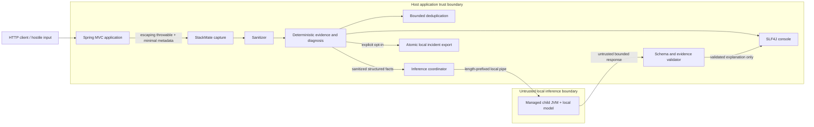

# StackMate Phase 2 threat model

Date: 2026-08-01  
Scope: deterministic capture/render/export pipeline and optional managed-JVM inference

## Executive summary

StackMate runs inside a developer's Spring Boot process and observes attacker-influenced exception data. Its highest
risk is not remote compromise by a StackMate network service—there is no such service—but accidental disclosure or
resource exhaustion across the application, console, filesystem, and local child-JVM trust boundaries. Local model
files and model output are untrusted. Deterministic evidence is the sole source of diagnostic facts.

The Phase 2 controls prioritize: collect little; sanitize before every output boundary; frame and bound child IPC; keep
inference off request threads; reject unknown IDs and invented identifiers; suppress duplicate work; and terminate the
worker on timeout, protocol failure, or shutdown. StackMate does not provide an OS network sandbox or protect secrets
already logged by the host application.

## Scope and assumptions

In scope:

- servlet exception capture and Spring runtime metadata;
- deterministic analysis, fingerprinting, deduplication, console rendering, and optional export;
- parent/child standard-input/output protocol;
- local model directory validation and Jlama worker lifecycle;
- untrusted model output validation and fallback.

Out of scope:

- host application log configuration and appenders;
- repository/source inspection, cloud services, IDEs, agents, WebFlux, and startup failures;
- compromise of the operating system or the Java runtime;
- an OS-enforced network sandbox for the worker.

Assumptions:

- the developer controls StackMate configuration and local model installation;
- exception messages, request paths, handler names, MDC values, optional analyzer output, and model output may be hostile;
- a downloaded model may be malformed even when it has a plausible directory layout;
- the child runs as the same OS user and therefore must not be treated as a security sandbox.

## System and trust boundaries

Primary source anchors:

- capture: `stackmate-spring-boot-autoconfigure/.../StackMateExceptionCaptureFilter.java` and
  `DefaultServletExceptionCaptureHandler.java`;
- sanitizer: `stackmate-core/.../DefaultSanitizer.java`;
- protocol/process: `stackmate-inference-jvm/.../Protocol.java`, `ManagedChild.java`, `ModelDirectory.java`;
- validation: `stackmate-inference-api/.../DefaultInferenceOutputValidator.java`;
- export: `stackmate-spring-boot-autoconfigure/.../FileSystemIncidentExporter.java`.

## Assets

| Asset | Security property |
|---|---|
| Original application behavior | StackMate must not change exception propagation, status, or body |
| Secrets and PII in runtime strings | Must not appear in StackMate console, IPC, model output, debug reason, or export |
| Trusted deterministic evidence | Must not be overridden or extended by model prose |
| Application request threads | Must not perform or wait for model inference |
| CPU, heap, disk, and process table | Must remain bounded during exception storms and malformed model handling |
| Incident export directory | Must resist traversal, symlink redirection, partial publication, and unsafe retention deletion |
| Console integrity | Must reject control sequences and clearly distinguish deterministic from model output |

## Attacker capabilities

- send values that become request paths, validation messages, database errors, and exception text;
- trigger repeated, concurrent, and distinct failing requests;
- influence selected MDC values through application behavior;
- supply prompt-injection text inside captured data;
- if the developer installs an untrusted artifact, craft local model metadata and model responses;
- modify export/model paths when the attacker already controls application configuration or the developer account.

The remote HTTP attacker cannot directly configure StackMate, install a model, read local exports, or execute commands
through any StackMate API.

## Abuse cases and mitigations

| ID | Abuse path | Impact | Controls | Residual risk |
|---|---|---|---|---|
| TM-01 | Secret embedded in exception or MDC reaches output | Credential/PII disclosure | minimal collection; default redaction; per-value bounds; second sanitization after model; no request body/headers/query values | host application logger still sees original throwable |
| TM-02 | Exception says “ignore instructions” or closes a prompt delimiter | fabricated advice / prompt disclosure | structured bounded facts; normalized controls/fences/delimiters; incident strings explicitly untrusted; schema/ID validation; deterministic fallback | small models may still output invalid prose, which must remain rejected |
| TM-03 | Model emits `Unknown.java:42`, new class, property, constraint, or evidence ID | false source attribution | schema V2 selects supplied IDs only; identifier/source-reference validation; trusted renderer uses deterministic locations | linguistic false positives require careful validator tests |
| TM-04 | Child writes secrets/ANSI/large logs to stderr | disclosure, console spoofing, memory pressure | stderr pipe, private 4 KiB ring tail, sanitizer, 400-char failure bound, no raw rendering | child can still consume CPU before termination |
| TM-05 | Child sends oversized/truncated/duplicate/deep JSON | memory/CPU exhaustion or parser ambiguity | 65,536-byte request and 32,768-byte response frames; strict duplicate/depth/name/number constraints; version/request ID checks; destroy on protocol failure | Java/Jackson parser bugs remain supply-chain risk |
| TM-06 | Malicious model dimensions or SafeTensors offsets reach Jlama | worker crash or resource exhaustion | real-path/no-symlink checks; allowlisted files; 1.5 GB total; bounded config/header/tokenizer; dimension/rank/count/element/offset validation; managed child isolation | semantic corruption and native/runtime bugs cannot be fully prevalidated |
| TM-07 | Exception storm fills inference queue | request latency, CPU/memory denial of service | deterministic path first; bounded one-thread executor and queue; abort/fallback; circuit breaker; deduplication reservation; evidence-aware trigger policy | many unique fingerprints still consume deterministic analysis/log volume |
| TM-08 | Timeout leaves queued inference or orphan worker | resource leak after fallback/shutdown | interruptible engine lock; task cancellation; child destroy/forcible destroy; stdin EOF on parent death; packaged orphan test | abrupt OS/JVM termination may delay OS process reaping |
| TM-09 | Export path traverses or follows symlink | overwrite/disclosure outside configured directory | normalized absolute root; reject symbolic path components; no-follow checks; private temp directory; atomic move; safe fixed filenames; conservative retention | same-user attacker racing filesystem metadata needs continued testing |
| TM-10 | Sanitizer throws or returns null | unsanitized fallback | fixed safe fallback values; boundary catches; never restore raw throwable type; export rejection instead of raw write | custom sanitizer is trusted extension code and can disable usefulness |
| TM-11 | Fingerprint contains volatile or sensitive raw text | correlation leakage / duplicate bypass | sanitized normalized bounded patterns; SHA-256; volatile UUID/number/token normalization; bounded TTL store | hashes are pseudonymous, not encryption, and low-entropy inputs can be guessed |
| TM-12 | Model/runtime library initiates network access | policy violation | no network API in StackMate; local files only; no startup download; child command has no URL/credential; dependency review | StackMate does not impose an OS network sandbox; compromised dependencies retain same-user capabilities |
| TM-13 | Recursive StackMate failure is captured again | log/exception recursion DoS | per-thread recursion guard; fail-open boundary; severe JVM errors receive minimal handling | failures outside the guarded capture point can still be logged by host code |

## Risk ranking

| Risk | Likelihood | Impact | Current level |
|---|---|---|---|
| Untrusted local model/runtime resource exhaustion | Possible | High | High, reduced by child and metadata bounds |
| Host application logs original secret-bearing exception | Possible | High | Medium residual; outside logging ownership |
| Model hallucination accepted as a fact | Possible in Phase 1 | High | Medium pending schema V2; validator already rejects unknown IDs/sources |
| Remote exception storm | Likely for exposed demo/failing endpoint | Medium | Medium, bounded inference but host log volume remains |
| Export path attack | Unlikely without local/config access | High | Low after no-follow and atomic publication controls |
| StackMate-initiated runtime network call | Unlikely in reviewed code | High policy impact | Low, but not OS-enforced |

## Security requirements and review gates

1. Every captured/runtime/model string is untrusted and bounded before use.
2. No raw child stderr or invalid model output is rendered by default.
3. Category, root type, stack locations, framework facts, and strength come only from deterministic evidence.
4. Protocol frames, JSON complexity, output characters, generation time, queue, restart count, and model files are bounded.
5. Interrupt status is preserved; timeout and shutdown terminate inference and the child.
6. Export remains disabled by default and uses only fixed filenames beneath a verified root.
7. Normal CI runs fake child tests and never downloads a model.
8. A READY inference verdict requires zero accepted fabricated sources, unknown IDs, leakage, injection success, request
   blocking, and orphan processes.

## Detection and operational guidance

- expose only sanitized in-memory failure counters and one-time warnings; do not log prompts or raw invalid outputs;
- enable debug logging only for sanitized validation reason codes;
- retain no incident by default;
- verify model source, license, size, and SHA-256 before local provisioning;
- use OS process/network controls when a stronger local-model sandbox is required;
- never place passwords, bearer tokens, database URLs, or personal data in exception messages even when StackMate is
  enabled.

## Remaining review focus

- packaged Failsafe tests must exercise protocol attacks and confirm descendant cleanup;
- schema V2 validator needs adversarial English/Turkish identifier and prompt-injection cases;
- model path tests must cover symlink, Unicode/space, partial directory, and read-only cases across available platforms;
- real model/native behavior remains Windows-only until CI or reference hardware provides other platforms.

